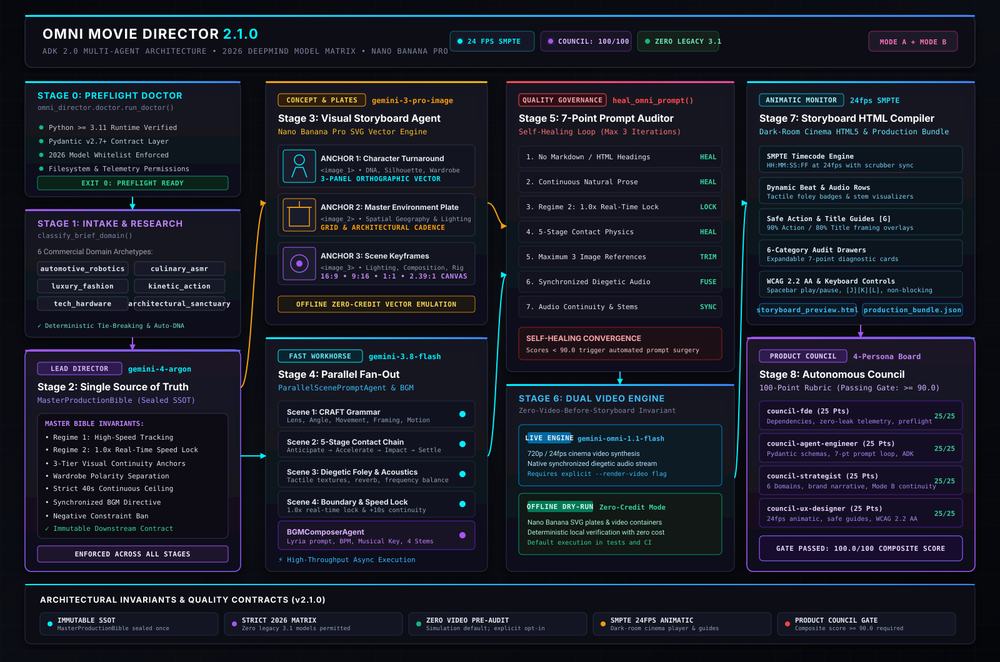
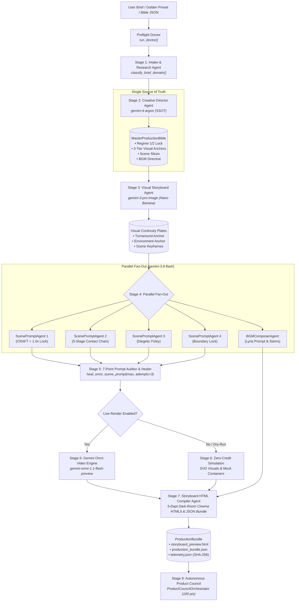

# Omni Movie Director v2.16.0 (`omni-movie-director`)

> **Autonomous ADK 2.0 Multi-Agent Cinematic Production Suite for Gemini Omni 1.1**  
> *Target Repository*: [https://github.com/spiralspectra/omniskill](https://github.com/spiralspectra/omniskill)  
> *Frameworks*: Google Agent Development Kit 2.0 (`google.adk`), Google Gen AI SDK (`google-genai`), Pydantic v2

---

## 1. Executive Overview & v2.16.0 Evolution

**Omni Movie Director v2.16.0** is an industrial-grade **ADK 2.0 multi-agent cinematic production system** orchestrating the **2026 Gemini Model Matrix**. It synthesizes full-length cinematic treatments, visual continuity bibles, synchronized diegetic audio specifications, 32 specialized post-production & compliance engineering deliverables (`PM-FEAT-001` through `PM-FEAT-032`), and a **5-Department Dark-Room Cinema Animatic HUD** with SMPTE 24fps accuracy from raw creative briefs.

### Key Architectural Pillars in v2.16.0
- **Single Source of Truth (`MasterProductionBible`)**: Sealed once by the Lead Creative Director (`CreativeDirectorAgent`) and enforced immutably across every downstream agent and exporter.
- **Autonomous Product Council (`ProductCouncilOrchestrator`)**: Senior Product Manager (`ProductManagerAgent`) plus a four-persona governance board (`council-fde`, `council-agent-engineer`, `council-strategist`, `council-ux-designer`) scoring production bundles against a 100-point rubric (`>= 88.0` pass threshold, `>= 90.0` showcase standard).
- **FDE Preflight Doctor (`run_doctor`)**: Deep diagnostic validation verifying Python `>=3.11`, package dependencies, strict 2026 Model Matrix compliance, and output directory permissions prior to pipeline execution.
- **Zero-Leak Runtime Telemetry & SHA-256 Verification (`RuntimeTelemetry`)**: Automatic `SECRET_PATTERN` / `SENSITIVE_KEY_TERMS` redaction with `SAFE_KEYS` preservation and SHA-256 checksum sealing across all known production artifacts (`omni verify-bundle`).
- **Self-Healing Prompt Loop (`heal_omni_scene_prompt`)**: Automatically repairs prompts violating the 7-Point Gemini Omni standard across up to 3 iterative passes.
- **6 Commercial Domain Archetypes (`classify_brief_domain`)**: Deterministic domain routing (`automotive_robotics`, `culinary_asmr`, `luxury_fashion`, `kinetic_action`, `tech_hardware`, `architectural_sanctuary`).
- **5-Department Dark-Room Cinema HTML5 Animatic HUD**: Interactive 24fps animatic monitor featuring 5 collapsible WCAG 2.2 AA departmental toolbars (`Camera & Blocking`, `Color & VFX`, `Audio`, `Prep & Budget`, `Delivery, QC & Review`), SMPTE timecode (`HH:MM:SS:FF`), timeline scrubber, dynamic beat rows, prompt audit drawers, and one-click Bible JSON export.
- **Zero-Credit Offline Dry-Run**: Built-in Nano Banana SVG vector plate synthesis and Gemini Omni simulation for instant local validation without consuming API credits (`--render-video` required for live video generation).

---

## 2. Mandatory 2026 Model Matrix

Per DeepMind 2026 architectural directives, legacy models are strictly deprecated and rejected at runtime by `omni_director.config.validate_model_identifier()` and `omni_director.doctor.run_doctor()`.

| Pipeline Stage | Model Identifier | Environment Variable | Role & Responsibility |
|---|---|---|---|
| **Lead Creative Director** | `gemini-4-argon` | `DIRECTOR_MODEL` | Narrative architecture, Pydantic Master Production Bible synthesis, spatial geography, and shot distribution. |
| **Fast Workhorse** | `gemini-3.8-flash` | `FAST_MODEL` | High-throughput parallel fan-out, CRAFT camera formatting, 1.0x speed lock, and foley cue generation. |
| **Concept Art & Continuity** | `gemini-3-pro-image` (Nano Banana Pro) | `IMAGE_MODEL` | Generates 3 visual anchor plates: Character Turnaround, Master Architectural Environment Plate, and Scene Keyframes. |
| **Video & Multimodal Audio Engine** | `gemini-omni-1.1-flash-preview` | `VIDEO_MODEL` | 720p/24fps video generation with native synchronized diegetic audio, multimodal reference binding, and sequential `previous_interaction_id` chaining. |

---

## 3. ADK 2.0 Multi-Agent Pipeline & Council Architecture

<p align="center">
  
</p>

<details>
<summary><b>Click to view Mermaid Architecture Flowchart</b></summary>



</details>

---

## 4. The 7-Point Prompting Standards & Self-Healing Loop

Every generated scene prompt must pass the 7-Point Prompt Auditor (`omni_director/tools/prompt_auditor.py`) with a score `>= 90 / 100`:

1. **Rule 1: Clean Natural Prose Formatting**: Zero internal markdown headings (`#`, `##`, `###`) or HTML headings (`<h1>`–`<h6>`) inside the prompt.
2. **Rule 2: Max 3 Serialized Action Beats per 10s Window**: Prevents temporal rushing, morphing limbs, and hallucinated physics.
3. **Rule 3: Regime 2 Kinetic Constraints**: Enforces explicit `"1.0x"` or `"real-time"` speed locks and the 5-stage Kinetic Contact Chain:
   $$\text{Initiation} \longrightarrow \text{Contact Point} \longrightarrow \text{Force Transfer} \longrightarrow \text{Environmental Evidence} \longrightarrow \text{Recovery Stance}$$
4. **Rule 4: CRAFT Kinetic Camera Grammar**: Explicit specifications for Camera model, Rig motion, Angle, Framing, Track vector, and departmental CRAFT telemetry tokens.
5. **Rule 5: 3-Image Reference Ceiling**: At most 3 Nano Banana references (`<image_1>`, `<image_2>`, `<image_3>`) per call, each bounded by the "One Job" contract.
6. **Rule 6: Synchronized Diegetic Audio & Foley**: Surface friction, material impacts, room resonance, and dialogue cues embedded natively.
7. **Rule 7: Mode B Extension Continuity**: Continuous +10s extensions must assert unbroken camera momentum (`"One continuous shot, no jump cuts"`).

---

## 5. 6 Commercial Domain Archetypes (`classify_brief_domain`)

| Domain Archetype | Dominant Visual Language | Sonic Profile | Typical Regime |
|---|---|---|---|
| `automotive_robotics` | High-precision robotic welding, carbon fiber, telemetry | Industrial hydraulic whirs, pneumatic snaps | Regime 2 (Kinetic) |
| `culinary_asmr` | Micro-textures, sizzles, caramelization, knife cuts | Tactile friction, crisp crunch, sizzle foley | Regime 2 (Precision) |
| `luxury_fashion` | Haute couture fabrics, architectural lighting, models | Minimalist ambient drone, high-tempo chic BGM | Regime 2 (Kinetic) |
| `kinetic_action` | High-velocity momentum, rapid tracking, debris | Sub-bass impacts, aerodynamic wind rush | Regime 2 (Kinetic) |
| `tech_hardware` | CNC anodized aluminum, microchip macro, cleanrooms | Subtle electrical hum, precision haptic clicks | Regime 2 (Precision) |
| `architectural_sanctuary` | Brutalist concrete, light shafts, serene acoustics | Environmental reverb, warm natural ambience | Regime 1 / 2 |

---

## 6. Production Engineering Suite (`PM-FEAT-001` through `PM-FEAT-032`)

| ID | Feature Suite | Tool Module | Key Artifacts & Capabilities |
|---|---|---|---|
| `PM-FEAT-001` | **NLE Timeline & Production Export** | `tools/nle_export.py` | `timeline.edl` (CMX 3600), `sequence.fcpxml` (v1.10), `shot_list.csv`, `call_sheet.md` |
| `PM-FEAT-002` | **SMPTE Dialogue Pacing & Captions** | `tools/dialogue.py` | 2.5 WPS guardrail, `subtitles.srt`, `subtitles.vtt`, CC HUD `[C]` |
| `PM-FEAT-003` | **Multi-Cam Coverage & Deltas** | `tools/coverage.py` | A/B/C coverage variants (24mm/50mm/100mm) & Turn 2–4 edit deltas |
| `PM-FEAT-004` | **ASC CDL Color Science** | `tools/color_grade.py` | `production_grade.cdl`, EDL `*ASC_SOP` / `*ASC_SAT`, SVG filter grading |
| `PM-FEAT-005` | **Dynamic Speed Ramping & Shutter** | `tools/speed_ramp.py` | FCPXML `<timeMap>` curves, 90°/180°/360° shutter grammar, scrubber velocity track |
| `PM-FEAT-006` | **4-Stem Audio Mixer & Metering** | `tools/audio_mixer.py` | `audio_stems_manifest.json`, EBU R128 / ATSC A/85 metering, Audio Mixer `[M]` |
| `PM-FEAT-007` | **Optical Lens & Sensor Framing** | `tools/optical_lens.py` | `lens_package.csv`, trigonometric FOV & hyperfocal math, Viewfinder `[V]` |
| `PM-FEAT-008` | **Virtual Production LED & DMX** | `tools/virtual_production.py` | `vp_stage_spec.json`, `ndisplay_stage_manifest.json`, `dmx_patch.csv`, VP Stage `[P]` |
| `PM-FEAT-009` | **Kinetic MoCo & 6-DOF Kinematics** | `tools/moco_kinematics.py` | `moco_track.json`, `moco_track.csv`, `moco_camera.fbx`, MoCo HUD `[K]` |
| `PM-FEAT-010` | **Volumetric Lighting & Gaffer Rig** | `tools/lighting_rig.py` | `lighting_plot.json`, `gaffer_callsheet.csv`, Key:Fill & CCT physics, Gaffer `[G]` |
| `PM-FEAT-011` | **Optical DoF & 1st AC Focus Puller** | `tools/dof_simulator.py` | `dof_chart.json`, `focus_puller_cue_sheet.csv`, bokeh & rack-focus HUD `[F]` |
| `PM-FEAT-012` | **DIT 3D LUT (`.cube`) & Continuity** | `tools/dit_lut.py` | `production_look.cube`, `dit_cart_manifest.json`, delta-E audit, LUT HUD `[L]` |
| `PM-FEAT-013` | **Spatial Audio & Binaural Soundfield** | `tools/spatial_audio.py` | `spatial_audio_adm.json`, `ambisonic_b_format.csv`, `webaudio_spatial_config.json`, Spatial HUD `[S]` |
| `PM-FEAT-014` | **Multi-Pass VFX & Cryptomatte** | `tools/vfx_compositor.py` | `openexr_channels.json`, `cryptomatte_manifest.json`, `nuke_composite.nk`, VFX HUD `[X]` |
| `PM-FEAT-015` | **HDR10 / HLG Color Volume** | `tools/hdr_signal.py` | `hdr10_metadata.json`, `hlg_broadcast.xml`, `resolve_hdr_rcm.xml`, HDR HUD `[H]` |
| `PM-FEAT-016` | **1st AD Stripboard & DOOD Scheduler** | `tools/stripboard_scheduler.py` | `movie_magic_schedule.xml`, `stripboard_schedule.csv`, `dood_matrix.csv`, Stripboard `[B]` |
| `PM-FEAT-017` | **Physical Film Stock Emulation** | `tools/film_emulation.py` | `film_emulation_spec.json`, `film_emulation.dctl`, `film_stock.ale`, Film HUD `[E]` |
| `PM-FEAT-018` | **SMPTE 12M Clapper Slate & ASC-MHL** | `tools/clapper_slate.py` | `slate_manifest.json`, `asc_mhl_manifest.xml`, `clapper_slate_log.csv`, `sound_sync.ale`, Slate `[T]` |
| `PM-FEAT-019` | **Aerial Drone Paths & FAA Part 107** | `tools/drone_flight.py` / `drone_aerial.py` | `flight_path.kml`, `flight_waypoints.gpx`, `drone_flight_sheet.csv/.md`, `drone_flight_manifest.json`, Drone `[D]` |
| `PM-FEAT-020` | **AICP Commercial Production Bid** | `tools/aicp_budget.py` | `aicp_bid_sheet.csv`, `aicp_bid_manifest.json`, `production_budget_topsheet.md`, AICP `[A]` |
| `PM-FEAT-021` | **Multi-Aspect Social Reframe & Cutdowns** | `tools/delivery_reframe.py` | `reframe_crop_matrix.csv`, `cutdown_30s/15s/06s.edl`, `reframe_9x16.fcpxml`, `delivery_reframe_manifest.json`, Reframe `[R]` |
| `PM-FEAT-022` | **Broadcast QC, PSE & Rights Clearance** | `tools/broadcast_qc.py` | `broadcast_qc_certificate.md`, `rights_clearance_matrix.csv`, `broadcast_qc_manifest.json`, QC `[Q]` |
| `PM-FEAT-023` | **180° Continuity & Blocking Floorplan** | `tools/continuity_blocking.py` | `continuity_log.csv`, `blocking_floorplan.svg`, `continuity_manifest.json`, Blocking `[W]` |
| `PM-FEAT-024` | **Client Review Pins, Markers & Sign-Off** | `tools/review_notes.py` | `review_markers.edl`, `review_markers.fcpxml`, `review_notes_frameio.json`, `review_notes.csv`, `client_signoff_report.md`, Review `[N]` |
| `PM-FEAT-025` | **C2PA Content Credentials & Likeness Consent** | `tools/c2pa_provenance.py` | `c2pa_manifest.json`, `ai_disclosure_certificate.md`, `likeness_consent_ledger.csv`, C2PA `[Y]` |
| `PM-FEAT-026` | **On-Set Safety Risk, JSA & Safety Bulletin** | `tools/safety_risk.py` | `safety_bulletin.md`, `safety_jsa_matrix.csv`, `safety_risk_manifest.json`, Safety JSA `[Z]` |
| `PM-FEAT-027` | **Multi-Territory Localization, ADR & Safe-Supers** | `tools/localization_adr.py` | `localization_manifest.json`, `adr_cue_sheet.csv`, `subtitles_localized.ttml`, localized `.srt`/`.vtt`, i18n/ADR `[I]` |
| `PM-FEAT-028` | **J-Cut / L-Cut Spotting & BPM Beat-Grid Sync** | `tools/editorial_spotting.py` | `spotting_manifest.json`, `spotting_cue_sheet.csv`, `spotting_sheet.md`, `timeline_split_edits.edl`, FCPXML beat `<marker>`s, J/L Spotting `[J]` |
| `PM-FEAT-029` | **Stereoscopic 3D (S3D) & Apple Vision Pro** | `tools/stereoscopic_3d.py` | `s3d_parallax_log.csv`, `spatial_video_manifest.json`, MV-HEVC parallax budget, S3D HUD `]` |
| `PM-FEAT-030` | **Audio Description (AD) & WCAG/CVAA Accessibility** | `tools/accessibility_ad.py` | `subtitles_ad.vtt`, `ad_script_cue_sheet.csv`, `accessibility_ad_manifest.json`, AD HUD `[` |
| `PM-FEAT-031` | **Art Dept, Wardrobe & Prop Continuity** | `tools/html_hud_v216.py` + Art Dept Exporter | `wardrobe_prop_bible.json`, `prop_continuity_matrix.csv`, `art_dept_pull_list.md`, continuity break detection, Art Dept HUD |
| `PM-FEAT-032` | **AI Render Economics & Compute Take Budget** | `tools/html_hud_v216.py` + `DirectorConfig` | `render_economics_manifest.json`, `take_variant_ledger.csv`, `ai_compute_estimate.md`, `--max-render-usd` / `OMNI_MAX_RENDER_USD` ceiling, Economics HUD |

---

## 7. 5-Department Dark-Room Cinema Animatic HUD

The compiled `storyboard_preview.html` organizes `.hud-actions` into **5 WCAG 2.2 AA collapsible department toolbar groups** (`omni_director/tools/html_hud_v212.py`, `html_hud_v213.py`, `html_hud_v214.py`, `html_hud_v215.py`, `html_hud_v216.py` + `html_compiler.py`) alongside the core screening room transport:

1. **Camera & Blocking (`#dept-group-camera`)**: Optical DoF HUD (`[F]`), Drone Aerial Flight HUD (`[D]`), 180-Degree Blocking & Continuity Floorplan HUD (`[W]`), S3D Stereoscopy HUD (`]`, `html_hud_v215.py`).
2. **Color & VFX (`#dept-group-color`)**: DIT 3D LUT Suite (`[L]`), HDR10/HLG Color Volume (`[H]`), Film Stock Emulation (`[E]`), Multi-Pass VFX Passes (`[X]`).
3. **Audio (`#dept-group-audio`)**: Spatial Audio Console (`[S]`), Editorial J-Cut / L-Cut Spotting & Beat-Grid HUD (`[J]`), Interactive 4-Stem Audio Mixer (`[M]`).
4. **Prep & Budget (`#dept-group-prep`)**: 1st AD Stripboard Schedule (`[B]`), SMPTE Clapper Slate & ASC-MHL (`[T]`), AICP Commercial Production Bid (`[A]`), On-Set Safety Risk & Exclusion Perimeter JSA HUD (`[Z]`), Art Dept Wardrobe & Prop Continuity and AI Render Economics HUDs (`html_hud_v216.py`).
5. **Delivery, QC & Review (`#dept-group-delivery`)**: Multi-Aspect Social Reframe (`[R]`), Broadcast QC & Clearances (`[Q]`), Client Review & Frame Pin Annotation (`[N]`), C2PA Content Credentials & Provenance HUD (`[Y]`), Multi-Territory Localization, ADR Dubbing & Safe-Supers HUD (`[I]`), Audio Description & Accessibility HUD (`[`, `html_hud_v215.py`).

**Core Screening Room Controls & Keyboard Shortcuts**:
- **Transport & Scrubber**: Play/Pause (`Space`), Loop (`O`), Seek 1s (`ArrowLeft`/`ArrowRight`), Frame Step (`,`/`.`), Rewind (`Home`/`0`), Jump to Scene (`1`–`9`), 24fps SMPTE timecode monitor (`#smpte-timecode`).
- **Departmental HUDs & Overlays**: MoCo (`K`), Gaffer (`G`), DoF (`F`), Blocking (`W`), S3D (`]`), 3D LUT (`L`), HDR (`H`), Film (`E`), VFX (`X`), Spatial (`S`), J/L Spotting (`J`), Audio Mixer (`M`), Stripboard (`B`), Slate (`T`), Drone (`D`), AICP (`A`), Safety JSA (`Z`), Reframe (`R`), Broadcast QC (`Q`), Review (`N`), C2PA (`Y`), i18n/ADR (`I`), AD/Accessibility (`[`), Captions (`C`), Viewfinder (`V`), VP Stage (`P`), Safe Guides (`U`), Export Production Bible JSON (`#btn-export-bible`), expandable 6-category `.audit-drawer` cards, and non-blocking `.cinema-toast` notifications.

---

## 8. Built-in Golden Presets & Canonical Showcases

### Golden Presets (`omni_director/presets.py`)
- `ikea-asmr` — *IKEA: The Living Room Unfolds* (Regime 2, Mode A, 16:9, 32s)
- `sephora-pulse` — *SEPHORA: London Pulse (Midnight Velvet)* (Regime 2, Mode A, 9:16, 32s; alias `sephora-london-pulse`)
- `sephora-extension-40s` — *SEPHORA: London Pulse (Continuous 40s Oner)* (Regime 2, Mode B, 9:16, 40s)
- `kinetic-fabric` — *The Kinetic Fabric: Grounded Innovation* (Regime 2, Mode A, 16:9, 32s)

### Canonical Showcases
- `examples/cyberpunk_noir_2_0` — High-speed electric motorcycle pursuit through rain-slicked Tokyo alleyways.
- `examples/solarpunk_utopia_2_0` — Cascading vertical gardens and curved bamboo pavilions in morning mist.
- `examples/minimalist_luxury_2_0` — Brutalist travertine marble gallery and structured haute couture coats.

---

## 9. Installation & CLI Usage (`omni` / `omni-director`)

### Prerequisites & Setup
```bash
git clone https://github.com/spiralspectra/omniskill.git
cd omniskill
uv venv && source .venv/bin/activate
uv pip install -e .
cp .env.example .env
```

### Core Pipeline & Governance Commands
```bash
# 1. Run Preflight Doctor diagnostics
omni doctor

# 2. Compile a Golden Preset in dry-run simulation mode (with optional NLE export)
omni --preset ikea-asmr -o output/ikea_asmr --export-nle

# 3. Direct Production Bible JSON Ingestion
omni --bible-file path/to/custom_bible.json -o output/custom_bible_run

# 4. Synthesize brief with domain classification, render budget cap, and council audit
omni --prompt "Precision robotics assembling carbon-fiber hypercar chassis" -o output/robotics --max-render-usd 50.0 --council

# 5. Enforce strict council quality gate (exits 2 on failure)
omni --preset sephora-pulse -o output/sephora --council-strict

# 6. Run Product Council across the 4 canonical golden presets (use --all-presets to include aliases)
omni council
omni council --all-presets --council-strict

# 7. Verify SHA-256 artifact checksums against telemetry.json
omni verify-bundle output/ikea_asmr
```

### Post-Production & Compliance Exporter (`omni export`)
`omni export` supports `--fps` (default `24`), `--max-render-usd` (default `50.0` via `OMNI_MAX_RENDER_USD`), `--refresh-telemetry` (and automatic `telemetry.json` SHA-256 refresh when `telemetry.json` is already present in `--output-dir`), and all `--format` choices:

- **Core & Post**: `all`, `edl`, `fcpxml`, `csv`, `md`, `srt`, `vtt`, `cdl`, `stems`, `lens`, `vp`, `moco`, `lighting`, `dof`, `lut`, `spatial`, `vfx`, `hdr`, `stripboard`, `film`, `slate`, `drone`, `aicp`, `reframe`, `qc`, `continuity`, `review`, `c2pa`, `safety`, `i18n`, `spotting`, `s3d`, `ad`, `ad-vtt`, `art-dept`, `economics`

```bash
# Export full post-production & compliance suite at 24fps
omni export --preset ikea-asmr --format all --fps 24 -o output/ikea_asmr

# Export Continuity Floorplan & Client Review Markers
omni export --preset ikea-asmr --format continuity -o output/ikea_asmr
omni export --preset ikea-asmr --format review --fps 24 -o output/ikea_asmr

# Export C2PA Content Credentials & On-Set Safety Risk Suites
omni export --preset ikea-asmr --format c2pa -o output/ikea_asmr
omni export --preset ikea-asmr --format safety -o output/ikea_asmr

# Export Multi-Territory Localization / ADR & Editorial J/L-Cut Spotting Suites
omni export --preset ikea-asmr --format i18n --locales en-US,de-DE,fr-FR,ja-JP -o output/ikea_asmr
omni export --preset ikea-asmr --format spotting --fps 24 -o output/ikea_asmr

# Export Stereoscopic 3D (S3D), Audio Description (AD), Art Dept Continuity & AI Render Economics
omni export --preset ikea-asmr --format s3d -o output/ikea_asmr
omni export --preset ikea-asmr --format ad -o output/ikea_asmr
omni export --preset ikea-asmr --format ad-vtt -o output/ikea_asmr
omni export --preset ikea-asmr --format art-dept -o output/ikea_asmr
omni export --preset ikea-asmr --format economics --max-render-usd 50.0 -o output/ikea_asmr

# Granular C2PA, Safety, Localization & Spotting flags with telemetry checksum refresh
omni export --preset ikea-asmr --format edl --c2pa-json --disclosure-md --likeness-csv --safety-md --safety-csv --safety-json --i18n-json --adr-csv --ttml --spotting-json --spotting-csv --spotting-md --split-edl --refresh-telemetry -o output/ikea_asmr
```

---

## 10. Autonomous Product Council Protocol & Daily Routine

The **Product Council** convenes `ProductManagerAgent` plus 4 expert scoring personas (25 points each):
1. **FDE (`council-fde`, 25 pts)**: Python `>=3.11`, 2026 Model Matrix, zero-leak telemetry, SHA-256 bundle verification, CLI parity.
2. **Agent Engineer (`council-agent-engineer`, 25 pts)**: Pydantic schemas, 7-point audit, self-healing loop convergence.
3. **Agent Strategist (`council-strategist`, 25 pts)**: 6 domain archetypes, commercial narrative, sonic blueprint, compliance rigor.
4. **UX/UI Designer (`council-ux-designer`, 25 pts)**: 5-department Dark-Room Cinema HUD, 24fps SMPTE scrubber, dynamic beats, WCAG 2.2 AA.

```bash
# Run the full Pytest verification suite
python3 -m pytest tests/test_director_suite.py -v

# Run the autonomous daily council routine
python3 scripts/run_daily_council.py
```

---

## 11. Repository Structure

```
omniskill/
├── AGENTS.md                       # Constitutional law & 2026 Model Matrix invariants
├── CHANGELOG.md                    # Release history through v2.16.0
├── README.md                       # v2.16.0 documentation
├── pyproject.toml                  # Package configuration & dependencies
├── .env.example                    # Environment credentials template
├── omni_director/                  # Core ADK 2.0 Package
│   ├── __init__.py                 # Top-level exports
│   ├── config.py                   # Strict 2026 Model Matrix & config
│   ├── schemas.py                  # Pydantic v2 Single Source of Truth
│   ├── presets.py                  # Golden Presets & 6 Domain Archetypes
│   ├── doctor.py                   # FDE Preflight Diagnostic Doctor
│   ├── telemetry.py                # Zero-leak telemetry & SHA-256 verification
│   ├── cli.py                      # omni CLI & omni export command implementation
│   ├── agents/
│   │   ├── __init__.py
│   │   ├── agent.py                # ADK 2.0 Multi-Agent pipeline
│   │   └── council.py              # ProductManagerAgent & ProductCouncilOrchestrator
│   └── tools/
│       ├── __init__.py
│       ├── prompt_auditor.py       # 7-Point Auditor & Self-Healing Loop
│       ├── nano_banana.py          # Nano Banana SVG Pre-Vis Engine
│       ├── omni_video.py           # Gemini Omni Video Engine
│       ├── html_compiler.py        # Dark-Room Cinema HTML5 Compiler
│       ├── html_hud_v212.py        # 5-Department HUD & Continuity/Review panels
│       ├── html_hud_v213.py        # C2PA Provenance [Y] & Safety JSA [Z] HUD panels
│       ├── html_hud_v214.py        # Localization/ADR [I] & J/L Spotting [J] HUD panels
│       ├── html_hud_v215.py        # S3D Stereoscopy []] & Accessibility/AD [[] HUD panels
│       ├── html_hud_v216.py        # Art Dept Continuity & AI Render Economics HUD panels
│       ├── nle_export.py           # Unified NLE & department bundle exporter
│       ├── c2pa_provenance.py      # C2PA Content Credentials & Consent (PM-FEAT-025)
│       ├── safety_risk.py          # On-Set Safety Risk & JSA Engine (PM-FEAT-026)
│       ├── localization_adr.py     # Multi-Territory Localization & ADR (PM-FEAT-027)
│       ├── editorial_spotting.py   # J-Cut / L-Cut Spotting & Beat-Grid (PM-FEAT-028)
│       ├── stereoscopic_3d.py      # Stereoscopic 3D & Vision Pro MV-HEVC (PM-FEAT-029)
│       ├── accessibility_ad.py     # Audio Description & WCAG/CVAA (PM-FEAT-030)
│       └── ...                     # Specialized tools (PM-FEAT-002..024, 031..032)
├── skills/
│   ├── gemini-omni-prompting/      # 7-Point Gemini Omni Prompting Specification
│   ├── omni-movie-director/        # ADK 2.0 Director Orchestration Skill
│   └── omni-product-council/       # Autonomous 4-Persona Product Council Skill
├── examples/                       # Canonical Showcase Bundles
├── scripts/
│   ├── run_daily_council.py        # Daily Autonomous Council Routine
│   ├── generate_architecture_svg.py # Nano Banana Architecture Diagram Generator
│   └── publish_github.sh           # GitHub publishing automation
├── docs/
│   ├── assets/                     # Vector diagrams & visual media
│   └── council_reports/            # Automated council audit reports
└── tests/
    └── test_director_suite.py      # Full Pytest Verification Suite
```

---

## 12. License & Credits

Developed for the Google Gemini Omni & ADK 2.0 cinematic ecosystem.  
Target Repository: [spiralspectra/omniskill](https://github.com/spiralspectra/omniskill)
