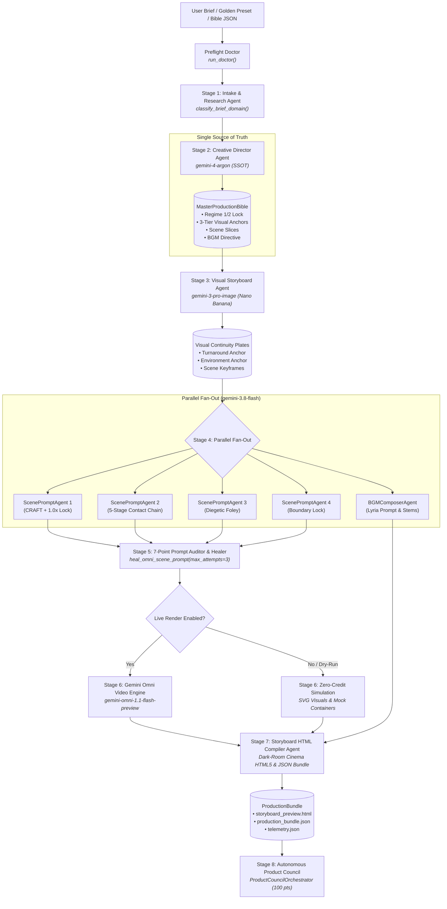

# Omni Movie Director 2.1 (`omni-movie-director`)

> **Autonomous ADK 2.0 Multi-Agent Cinematic Production Suite for Gemini Omni 1.1**  
> *Target Repository*: [https://github.com/spiralspectra/omniskill](https://github.com/spiralspectra/omniskill)  
> *Frameworks*: Google Agent Development Kit 2.0 (`google.adk`), Google Gen AI SDK (`google-genai`), Pydantic v2

---

## 1. Executive Overview & v2.1 Evolution

**Omni Movie Director 2.1** represents the industrial-grade evolution of autonomous cinematic prompt synthesis, expanding beyond experimental prompt generators into a self-governing **ADK 2.0 multi-agent architecture** equipped with an **Autonomous Product Council**, **FDE Preflight Doctor**, **Self-Healing Prompt Loop**, and an **Interactive 24fps Animatic Director's Monitor**.

### Key Architectural Pillars in v2.1
- **Single Source of Truth (`MasterProductionBible`)**: Sealed once by the Lead Creative Director and enforced across every downstream agent.
- **Autonomous Product Council (`ProductCouncilOrchestrator`)**: A four-persona automated governance board (`council-fde`, `council-agent-engineer`, `council-strategist`, `council-ux-designer`) scoring production bundles against a 100-point rubric.
- **FDE Preflight Doctor (`run_doctor`)**: Deep diagnostic validation verifying Python `>=3.11`, package dependencies, 2026 Model Matrix compliance, and output directory permissions prior to pipeline execution.
- **Self-Healing Prompt Loop (`heal_omni_scene_prompt`)**: Automatically repairs prompts violating 7-Point Omni standards (stripping markdown/HTML headings, restoring 1.0x real-time locks, injecting tactile foley, and enforcing Mode B continuity) across up to 3 iterative passes.
- **6 Commercial Domain Archetypes (`classify_brief_domain`)**: Intelligent classification routing briefs to domain-specific treatments (`automotive_robotics`, `culinary_asmr`, `luxury_fashion`, `kinetic_action`, `tech_hardware`, `architectural_sanctuary`) with deterministic tie-breaking.
- **Dark-Room Cinema HTML5 Animatic Monitor**: Interactive 24fps animatic player featuring SMPTE timecode (`HH:MM:SS:FF`), timeline scrubber, dynamic beat rows with color-coded audio badges, expandable 6-category audit drawers, JSON Production Bible export, non-blocking toast notifications, and WCAG 2.2 AA accessibility.
- **Dual-Mode Storytelling**: Seamlessly switches between **Mode A** (parallel multi-scene montage cuts binding up to 3 reference images) and **Mode B** (continuous +10s scene extension chains maintaining camera continuity up to 40s).
- **Zero-Credit Offline Dry-Run**: Built-in SVG vector rendering engine emulating Nano Banana pre-visualizations and Gemini Omni video simulation for instant local validation without consuming API credits.

---

## 2. Mandatory 2026 Model Matrix

Per DeepMind 2026 architectural directives, legacy models are strictly deprecated and rejected at runtime by `omni_director.config.validate_no_legacy_3_1_models()`.

| Pipeline Stage | Model Identifier | Environment Variable | Role & Responsibility |
|---|---|---|---|
| **Lead Creative Director** | `gemini-4-argon` | `DIRECTOR_MODEL` | Narrative architecture, Pydantic Master Production Bible synthesis, spatial geography, and shot distribution. |
| **Fast Workhorse** | `gemini-3.8-flash` | `FAST_MODEL` | High-throughput parallel fan-out, CRAFT camera formatting, 1.0x speed lock, and foley cue generation. |
| **Concept Art & Continuity** | `gemini-3-pro-image` (Nano Banana Pro) | `IMAGE_MODEL` | Generates 3 visual anchor plates: Character Turnaround, Master Architectural Environment Plate, and Scene Keyframes. |
| **Video & Multimodal Audio Engine** | `gemini-omni-1.1-flash-preview` | `VIDEO_MODEL` | 720p/24fps video generation with native synchronized diegetic audio, multimodal reference binding, and sequential `previous_interaction_id` chaining. |

---

## 3. ADK 2.0 Multi-Agent Pipeline & Council Architecture



---

## 4. The 7-Point Prompting Standards & Self-Healing Loop

Every generated scene prompt must strictly pass the 7-Point Prompt Auditor:

1. **Rule 1: Clean Natural Prose Formatting**: Zero internal markdown headings (`#`, `##`, `###`) or HTML headings (`<h1>`–`<h6>`) inside the prompt. Gemini Omni's visual text engine misinterprets headings as literal graphic text overlay instructions.
2. **Rule 2: Max 3 Serialized Action Beats per 10s Window**: Prevents temporal rushing, morphing limbs, and hallucinated physics.
3. **Rule 3: Regime 2 Kinetic Constraints**: Enforces explicit `"1.0x"` or `"real-time"` speed locks and the 5-stage Kinetic Contact Chain:
   $$\text{Initiation} \longrightarrow \text{Contact Point} \longrightarrow \text{Force Transfer} \longrightarrow \text{Environmental Evidence} \longrightarrow \text{Recovery Stance}$$
4. **Rule 4: CRAFT Kinetic Camera Grammar**: Explicit specifications for Camera model, Rig motion, Angle, Framing, and Track vector.
5. **Rule 5: 3-Image Reference Ceiling**: At most 3 Nano Banana references (`<image_1>`, `<image_2>`, `<image_3>`) per call, each bounded by the "One Job" contract.
6. **Rule 6: Synchronized Diegetic Audio & Foley**: Surface friction, material impacts, room resonance, and dialogue cues embedded natively.
7. **Rule 7: Mode B Extension Continuity**: Continuous +10s extensions must assert unbroken camera momentum (`"One continuous shot, no jump cuts"`).

### Automated Self-Healing (`heal_omni_scene_prompt`)
When prompt defects are flagged, the self-healing loop automatically repairs the prompt:
- Strips markdown headings and HTML tags while preserving narrative context.
- Injects explicit `"1.0x real-time speed"` and physical invariants when in Regime 2.
- Injects synchronized tactile foley and room acoustics if diegetic audio is missing.
- Appends unbroken continuity markers for Mode B extension shots.
- Re-verifies the prompt across up to 3 iterative healing attempts.

---

## 5. 6 Commercial Domain Archetypes (`classify_brief_domain`)

Omni Movie Director 2.1 intelligently classifies input creative briefs into 6 domain archetypes:

| Domain Archetype | Dominant Visual Language | Sonic Profile | Typical Regime |
|---|---|---|---|
| `automotive_robotics` | High-precision robotic welding, carbon fiber, telemetry | Industrial hydraulic whirs, pneumatic snaps | Regime 2 (Kinetic) |
| `culinary_asmr` | Micro-textures, sizzles, caramelization, knife cuts | Tactile friction, crisp crunch, sizzle foley | Regime 2 (Precision) |
| `luxury_fashion` | Haute couture fabrics, architectural lighting, models | Minimalist ambient drone, high-tempo chic BGM | Regime 2 (Kinetic) |
| `kinetic_action` | High-velocity momentum, rapid tracking, debris | Sub-bass impacts, aerodynamic wind rush | Regime 2 (Kinetic) |
| `tech_hardware` | CNC anodized aluminum, microchip macro, cleanrooms | Subtle electrical hum, precision haptic clicks | Regime 2 (Precision) |
| `architectural_sanctuary` | Brutalist concrete, light shafts, serene acoustics | Environmental reverb, warm natural ambience | Regime 1 / 2 |

---

## 6. Built-in Golden Presets & Canonical Showcases

### Golden Presets
- `ikea-asmr` — *IKEA: The Living Room Unfolds* (Regime 2, Mode A, 16:9, 32s)
- `sephora-pulse` — *SEPHORA: London Pulse (Midnight Velvet)* (Regime 2, Mode A, 9:16, 32s)
- `sephora-extension-40s` — *SEPHORA: London Pulse (Continuous 40s Oner)* (Regime 2, Mode B, 9:16, 40s)
- `kinetic-fabric` — *The Kinetic Fabric: Grounded Innovation* (Regime 2, Mode A, 16:9, 32s)

### Canonical Showcases
- `examples/cyberpunk_noir_2_0` — High-speed electric motorcycle pursuit through rain-slicked Tokyo alleyways.
- `examples/solarpunk_utopia_2_0` — Cascading vertical gardens and curved bamboo pavilions in morning mist.
- `examples/minimalist_luxury_2_0` — Brutalist travertine marble gallery and structured haute couture coats.

---

## 7. Interactive Dark-Room Cinema HTML5 Monitor

The compiled `storyboard_preview.html` delivers a complete director's screening room:
- **Animatic Transport Bar & SMPTE Scrubber**: Play/Pause (`#btn-play-animatic`), 24fps SMPTE timecode monitor (`#smpte-timecode`), speed toggles (`0.5x`–`2.0x`), and draggable `.scrubber-track` scaled to total runtime.
- **Dynamic Beat Timeline Visualization**: Visual beat rows matching `len(scene.action_beats)` with color-coded badges (`[Dialogue]`, `[SFX]`, `[Ambience]`, `[Music]`).
- **Expandable Prompt Audit Drawers**: Clickable audit badges toggle `.audit-drawer` displaying the 6-category compliance breakdown.
- **One-Click Production Bible Export**: `#btn-export-bible` downloads the embedded `MasterProductionBible` JSON via Blob URL.
- **Non-Blocking Cinema Toast**: Real-time action feedback via `.cinema-toast` (zero blocking dialog calls).
- **WCAG 2.2 AA Accessibility & Shortcuts**: `Space` (Play/Pause), `ArrowLeft`/`ArrowRight` (Seek 1s), `1`/`2`/`3` (Jump to Scene), `T` (Cycle Tabs), `E` (Export Bible JSON).

---

## 8. Installation & CLI Usage (`omni` / `omni-director`)

### Prerequisites & Setup
```bash
git clone https://github.com/spiralspectra/omniskill.git
cd omniskill
uv venv && source .venv/bin/activate
uv pip install -e .
cp .env.example .env
```

### CLI Commands
```bash
# 1. Run Preflight Doctor diagnostics
omni doctor

# 2. Compile a Golden Preset in dry-run simulation mode
omni --preset ikea-asmr -o output/ikea_asmr

# 3. Direct Production Bible JSON Ingestion
omni --bible-file path/to/custom_bible.json -o output/custom_bible_run

# 4. Synthesize brief with domain classification and council audit
omni --prompt "Precision robotics assembling carbon-fiber hypercar chassis" -o output/robotics --council

# 5. Enforce strict council quality gate (exits 2 on failure)
omni --preset sephora-pulse -o output/sephora --council-strict

# 6. Run full multi-persona council evaluation across all presets
omni council
```

---

## 9. Autonomous Product Council Protocol & Daily Routine

The **Product Council** convenes 4 expert personas scoring up to 25 points each:
1. **FDE (`council-fde`, 25 pts)**: Environment doctor, 2026 Model Matrix, telemetry, Bible ingestion.
2. **Agent Engineer (`council-agent-engineer`, 25 pts)**: Pydantic schemas, 7-point audit, self-healing loop.
3. **Agent Strategist (`council-strategist`, 25 pts)**: 6 domain archetypes, commercial narrative, sonic blueprint.
4. **UX/UI Designer (`council-ux-designer`, 25 pts)**: Animatic player, SMPTE scrubber, dynamic beats, WCAG AA.

### Running Daily Council Verification
```bash
# Run the autonomous daily council runner
python3 scripts/run_daily_council.py
```
This regenerates all 3 showcase bundles, audits each against the 100-point rubric, outputs `docs/council_reports/latest_council_report.json` and `.md`, and enforces quality gates (`composite_score >= 90.0`, all scene audits `>= 90`).

### Automated Test Suite
```bash
python3 -m pytest tests/test_director_suite.py -v
```

---

## 10. Repository Structure

```
omniskill/
├── AGENTS.md                       # Constitutional law & 2026 Model Matrix invariants
├── README.md                       # Complete v2.1 documentation
├── pyproject.toml                  # Package configuration & dependencies
├── .env.example                    # Environment credentials template
├── omni_director/                  # Core ADK 2.0 Package
│   ├── __init__.py                 # Top-level exports
│   ├── config.py                   # Strict 2026 Model Matrix & config
│   ├── schemas.py                  # Pydantic v2 Single Source of Truth
│   ├── presets.py                  # 4 Golden Presets & 6 Domain Archetypes
│   ├── doctor.py                   # FDE Preflight Diagnostic Doctor
│   ├── telemetry.py                # Zero-leak execution telemetry
│   ├── cli.py                      # omni CLI command implementation
│   ├── agents/
│   │   ├── __init__.py
│   │   ├── agent.py                # 9 ADK Multi-Agent implementations
│   │   └── council.py              # ProductCouncilOrchestrator (4 Personas)
│   └── tools/
│       ├── __init__.py
│       ├── prompt_auditor.py       # 7-Point Auditor & Self-Healing Loop
│       ├── nano_banana.py          # Nano Banana SVG Pre-Vis Engine
│       ├── omni_video.py           # Gemini Omni Video Engine
│       └── html_compiler.py        # Dark-Room Cinema HTML5 Compiler
├── skills/
│   ├── gemini-omni-prompting/      # 7-Point Gemini Omni Prompting Specification
│   ├── omni-movie-director/        # ADK 2.0 Director Orchestration Skill
│   └── omni-product-council/       # Autonomous 4-Persona Product Council Skill
├── examples/                       # Showcase Bundles
│   ├── cyberpunk_noir_2_0/
│   ├── solarpunk_utopia_2_0/
│   ├── minimalist_luxury_2_0/
│   ├── ikea_asmr_2_0/
│   └── sephora_extension_40s_2_0/
├── scripts/
│   ├── run_daily_council.py        # Daily Autonomous Council Routine
│   └── publish_github.sh           # GitHub publishing automation
├── docs/
│   └── council_reports/            # Automated council audit reports
└── tests/
    └── test_director_suite.py      # Full Pytest Verification Suite
```

---

## 11. License & Credits

Developed for the Google Gemini Omni & ADK 2.0 cinematic ecosystem.  
Target Repository: [spiralspectra/omniskill](https://github.com/spiralspectra/omniskill)
