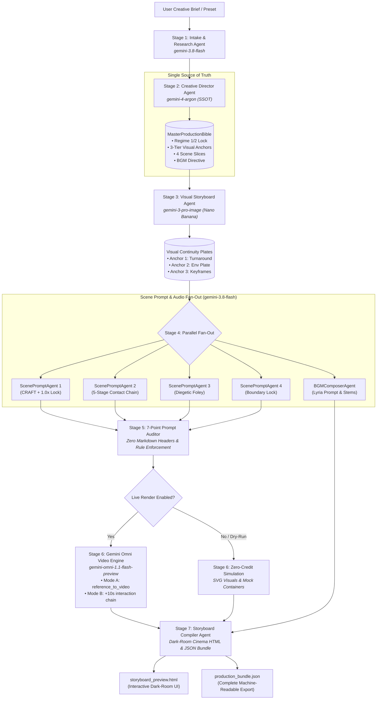

# Omni Movie Director 2.0 (`omni-movie-director`)

> **Autonomous ADK 2.0 Multi-Agent Cinematic Production Suite for Gemini Omni 1.1**  
> *Target Repository*: [https://github.com/spiralspectra/omniskill](https://github.com/spiralspectra/omniskill)  
> *Frameworks*: Google Agent Development Kit 2.0 (`google.adk`), Google Gen AI SDK (`google-genai`), Pydantic v2

---

## 1. Executive Overview & The Opal Evolution

**Omni Movie Director 2.0** represents the second-generation evolution of autonomous cinematic prompt synthesis, expanding beyond experimental monolithic prompt generation into an industrial-grade **ADK 2.0 multi-agent architecture**.

In early cinematic video generation (e.g., Project Opal), monolithic "God-prompts" suffered from severe context rot:
1. **Context Rot & Token Drift**: Overloading one prompt with character turnarounds, camera geometry, narrative beats, and audio foley caused the model to drop fine-grained constraints.
2. **Cross-Scene Identity Bleed**: Subsequent cuts subtly shifted character wardrobe, face structure, or room dimensions.
3. **Temporal Floatiness**: Lack of explicit real-time physical constraints caused AI video models to default to dreamy, disconnected slow-motion.
4. **Silent Video Hallucinations**: Prompt headers (`### Camera`, `### Audio`) were frequently misinterpreted by video generation models as literal on-screen text overlays.

### The ADK 2.0 Multi-Agent Solution
Omni Movie Director 2.0 eliminates prompt corruption through:
- **A Single Source of Truth (`MasterProductionBible`)**: Sealed once by the Lead Creative Director and enforced across every downstream agent.
- **Micro-Specialized Agent Topology**: Specialized agents handle Intake, Creative Direction, 3-Tier Visual Continuity Plates, Scene Prompt Fan-Out, Musical Composition, 7-Point Prompt Auditing, and Dark-Room UI Compilation.
- **Dual-Mode Storytelling**: Seamlessly switches between **Mode A** (parallel multi-scene montage cuts binding up to 3 reference images) and **Mode B** (continuous +10s scene extension chains maintaining camera continuity up to 40s).
- **Zero-Credit Offline Dry-Run**: Built-in SVG vector rendering engine emulating Nano Banana pre-visualizations and Gemini Omni video simulation for instant local validation without consuming API credits.

---

## 2. Mandatory 2026 Model Matrix

Per DeepMind 2026 architectural directives, **all legacy 3.1 models (`gemini-3.1-*`, `veo-3.1-*`) are strictly deprecated and rejected at runtime** by `omni_director.config.validate_no_legacy_3_1_models()`.

| Pipeline Stage | Model Identifier | Environment Variable | Role & Responsibility |
|---|---|---|---|
| **Lead Creative Director** | `gemini-4-argon` | `DIRECTOR_MODEL` | Narrative architecture, Pydantic Master Production Bible synthesis, spatial geography, and shot distribution. |
| **Fast Workhorse** | `gemini-3.8-flash` | `FAST_MODEL` | High-throughput parallel fan-out, CRAFT camera formatting, 1.0x speed lock, and foley cue generation. |
| **Concept Art & Continuity** | `gemini-3-pro-image` (Nano Banana Pro) | `IMAGE_MODEL` | Generates 3 visual anchor plates: Character Turnaround, Master Architectural Environment Plate, and Scene Keyframes. |
| **Video & Multimodal Audio Engine** | `gemini-omni-1.1-flash-preview` | `VIDEO_MODEL` | 720p/24fps video generation with native synchronized diegetic audio, multimodal reference binding, and sequential `previous_interaction_id` chaining. |

---

## 3. ADK 2.0 Architecture & Pipeline Flow



---

## 4. The 7-Point Gemini Omni Prompting Verification Checklist

Every generated scene prompt must strictly pass the 7-Point Prompt Auditor before execution:

1. **Rule 1: Clean Natural Prose Formatting**: Zero internal markdown headers (`#`, `##`, `###`) inside the generation prompt. Gemini Omni's internal visual text engine misinterprets markdown headers as graphic overlay text instructions.
2. **Rule 2: Max 3 Serialized Action Beats per 10s Window**: Prevents temporal rushing, morphing limbs, and hallucinated physics.
3. **Rule 3: Regime 2 Kinetic Constraints**: Enforces explicit `"1.0x"` or `"real-time"` speed lock and the 5-stage Kinetic Contact Chain:
   $$\text{Initiation} \longrightarrow \text{Contact Point} \longrightarrow \text{Force Transfer} \longrightarrow \text{Environmental Evidence} \longrightarrow \text{Recovery Stance}$$
4. **Rule 4: CRAFT Kinetic Camera Grammar**: Explicit specifications for **C**amera model, **R**ig motion, **A**ngle, **F**raming, and **T**rack vector.
5. **Rule 5: 3-Image Reference Ceiling**: At most 3 Nano Banana references (`<image_1>`, `<image_2>`, `<image_3>`) per call, each bounded by the "One Job" contract.
6. **Rule 6: Synchronized Diegetic Audio & Foley**: Surface friction, material impacts, room resonance, and dialogue cues embedded natively.
7. **Rule 7: Mode B Extension Continuity**: Continuous +10s extensions must assert unbroken camera momentum (`"One continuous shot, no jump cuts"`).

---

## 5. Built-in Golden Production Bibles

Omni Movie Director 2.0 ships with 4 pre-compiled golden production bibles ready for immediate zero-credit compilation or live execution:

### 1. `ikea-asmr` — *IKEA: The Living Room Unfolds*
- **Creative Regime**: Regime 2 (High-Kinetic & Precision Commercial)
- **Storytelling Mode**: Mode A (Parallel Montage Cut, 16:9, 32s)
- **Concept**: A flat-pack IKEA box violently trembles on blonde Scandinavian ash floors, then self-assembles into a pristine, serene living sanctuary with hyper-tactile ASMR foley (cardboard rips, pine dowel clicks, down cushion settling).

### 2. `sephora-pulse` — *SEPHORA: London Pulse (Midnight Velvet)*
- **Creative Regime**: Regime 2 (High-Kinetic Fashion Commercial)
- **Storytelling Mode**: Mode A (Parallel Montage Cut, 9:16 Vertical, 32s)
- **Concept**: Rain-slicked Soho cobblestones at midnight under glowing neon signage. Features Model Maya in scarlet-red patent trench and Model Kaelen in charcoal blazer, enforcing high-contrast wardrobe polarity with 138 BPM UK Garage beats.

### 3. `sephora-extension-40s` — *SEPHORA: London Pulse (Continuous 40s Oner)*
- **Creative Regime**: Regime 2 (Continuous Steadicam Oner)
- **Storytelling Mode**: Mode B (Continuous +10s Extension Chaining, 9:16 Vertical, 40s total runtime)
- **Concept**: An unbroken 40-second continuous Steadicam shot tracking Maya and Kaelen from the wet streets of Soho, through opening glass doors into 5600K beauty lights, concluding with an immaculate freeze-frame on the embossed SEPHORA bag.

### 4. `kinetic-fabric` — *The Kinetic Fabric: Grounded Innovation*
- **Creative Regime**: Regime 2 (Scientific Material Innovation)
- **Storytelling Mode**: Mode A (Parallel Montage Cut, 16:9, 32s)
- **Concept**: Exploration of an ultra-lightweight carbon-weave textile inside an aerodynamic wind tunnel laboratory, moving from microscopic fiber macro-shots to high-speed smoke deflection and elastic rebound.

---

## 6. Installation & Quickstart

### Prerequisites
- Python 3.10+ (tested on Python 3.14)
- `uv` package manager (recommended) or standard `pip`

```bash
# Clone the repository
git clone https://github.com/spiralspectra/omniskill.git
cd omniskill

# Create virtual environment and install dependencies
uv venv
source .venv/bin/activate
uv pip install -e .
```

### Environment Setup
Create a `.env` file based on `.env.example`:

```bash
cp .env.example .env
```

Configure your credentials:
```ini
GOOGLE_API_KEY="your-gemini-api-key"
DIRECTOR_MODEL="gemini-4-argon"
FAST_MODEL="gemini-3.8-flash"
IMAGE_MODEL="gemini-3-pro-image"
VIDEO_MODEL="gemini-omni-1.1-flash-preview"
```

### Running the CLI (`omni-director`)

```bash
# List all built-in golden presets
omni-director --list-presets

# Compile IKEA ASMR treatment in dry-run mode (instant SVG storyboard + bundle JSON)
omni-director --preset ikea-asmr -o examples/ikea_asmr_2_0

# Compile Sephora 40s Continuous Oner (Mode B extension chaining)
omni-director --preset sephora-extension-40s -o examples/sephora_extension_40s_2_0

# Run with a custom prompt
omni-director --prompt "A cyberpunk courier racing through Neo-Kyoto on an electric motorcycle" -o ./output/cyberpunk

# Run with live video rendering (consumes Gemini Omni credits)
omni-director --preset ikea-asmr --render-video -o ./output/ikea_live
```

---

## 7. Python Programmatic API

```python
from omni_director import DirectorPipeline, get_preset_bible

# Initialize pipeline
pipeline = DirectorPipeline()

# Load a golden preset
bible = get_preset_bible("sephora-pulse")

# Execute pipeline
bundle = pipeline.run(
    bible=bible,
    output_dir="./output/my_campaign",
    dry_run=True,
)

print(f"Compiled Dark-Room Cinema UI: {bundle.storyboard_html_path}")
print(f"Compiled Production Bundle:   {bundle.bundle_json_path}")
print(f"Auditor status:               {all(r.passed for r in bundle.audit_reports)}")
```

---

## 8. Running the Automated Test Suite

Omni Movie Director 2.0 includes a comprehensive test suite enforcing model tiering, Pydantic contracts, prompt rules, preset integrity, and end-to-end execution:

```bash
# Run pytest with uv
uv run pytest tests/test_director_suite.py -v
```

---

## 9. Repository Structure

```
omniskill/
├── omni_director/                  # Core Python ADK 2.0 Package
│   ├── __init__.py                 # Top-level exports
│   ├── config.py                   # Strict 2026 Model Matrix & Runtime Config
│   ├── schemas.py                  # Pydantic V2 State Contracts (SSOT)
│   ├── presets.py                  # Golden Production Bibles (IKEA, Sephora, Fabric)
│   ├── cli.py                      # omni-director CLI Command
│   ├── agents/                     # ADK 2.0 Multi-Agent Definitions
│   │   ├── __init__.py
│   │   └── agent.py                # Pipeline, Director, Visual, Fan-Out, Compiler Agents
│   └── tools/                      # Core Production Tools
│       ├── __init__.py
│       ├── prompt_auditor.py       # 7-Point Gemini Omni Prompt Auditor
│       ├── nano_banana.py          # Nano Banana 3-Tier SVG Storyboard Engine
│       ├── omni_video.py           # Gemini Omni Video & Synchronized Audio Engine
│       └── html_compiler.py        # Dark-Room Cinema HTML Animatic Compiler
├── skills/                         # Agent Skill Definitions
│   ├── gemini-omni-prompting/      # 7-Point Gemini Omni Prompting Specification
│   │   └── SKILL.md
│   └── omni-movie-director/        # ADK 2.0 Movie Director Orchestration Skill
│       ├── SKILL.md
│       └── references/             # Deep technical reference guides
│           ├── craft-camera-grammar.md
│           ├── nano-banana-character-anchors.md
│           ├── regime-1-vs-regime-2.md
│           └── seedance-contact-chains.md
├── examples/                       # Pre-compiled Golden Treatments
│   ├── ikea_asmr_2_0/
│   │   ├── storyboard_preview.html
│   │   └── production_bundle.json
│   ├── sephora_london_pulse_2_0/
│   └── sephora_extension_40s_2_0/
├── scripts/                        # Utility & Publishing Scripts
│   └── publish_github.sh           # GitHub repository publishing script
├── tests/                          # Automated Pytest Suite
│   └── test_director_suite.py
├── pyproject.toml                  # Package configuration & dependencies
├── .env.example                    # Environment template
└── README.md                       # Comprehensive documentation
```

---

## 10. License & Credits

Developed for the Google Gemini Omni & ADK 2.0 cinematic ecosystem.  
Target Repository: [spiralspectra/omniskill](https://github.com/spiralspectra/omniskill)
