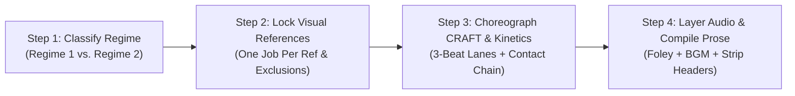

# Gemini Omni 1.1 Prompting Handbook (2026 Edition)

This handbook provides the authoritative prompt engineering standards for **Google DeepMind's Gemini Omni 1.1** (`gemini-omni-1.1-flash-preview`). It establishes deterministic prompt formulations for photorealistic video and synchronized diegetic audio generation, incorporating the **Seedance 2.5 Kinetic Physics Engine** to eliminate floatiness, object morphing, and visual drift.

*(Historical Context Note: Earlier 3.1 generation models provided foundational text-to-video baselines, but active production in 2026 mandates `gemini-omni-1.1-flash-preview` for video/audio synthesis, `gemini-4-argon` for creative direction, and `gemini-3.8-flash` for high-throughput prompt generation.)*

---

## 1. The Prescription Spectrum (Regime 1 vs. Regime 2)

Video generation prompts must balance creative world-knowledge with strict physical constraints. Prompts belong to one of two operational regimes:

```
                      THE PRESCRIPTION SPECTRUM
   Low Prescription                                      High Prescription
   (World-Knowledge)                                    (Kinetic & Physical)
  ◄────────────────────────────────────────────────────────────────────────►
   REGIME 1: Atmospheric & Narrative          REGIME 2: Kinetic Action & Precision
   • Landscapes, ambient lighting             • Fast martial arts, sports, acrobatics
   • Contemplative dialogue scenes            • Mechanical product assemblies (ASMR)
   • Organic fluid motion, weather            • High-speed vehicle pursuits, whip-pans
   • Trust model's cinematic priors           • Strict Seedance 5-part contact chains
```

### 1.1 Regime 1: World-Knowledge & Atmospheric Flow
- **When to use**: Establishing landscape shots, slow emotional portraits, natural weather phenomena, architectural walkthroughs, and dialogue scenes with minimal physical interaction.
- **Formulation Strategy**: Describe scene mood, sensory environment, lighting color temperature, and emotional tenor. Avoid micromanaging micro-movements so the model draws upon rich cinematic world knowledge.

### 1.2 Regime 2: High-Kinetic & Precision Commercial (Seedance Upgraded)
- **When to use**: Fast-paced commercial ads (e.g., IKEA self-assembly, SEPHORA runway struts), combat sequences, tactile product interactions, and rapid camera choreography.
- **Formulation Strategy**: Apply exhaustive kinetic constraints: the 5-Part Contact Chain, 1.0x real-time speed locks, CRAFT camera routing, serialized 3-beat action lanes, and rigid positive physical invariants.

---

## 2. The 5 Official Core Elements

Every production prompt for Gemini Omni must define five core dimensions:

```
┌─────────────────────────────────────────────────────────────────────────┐
│                      THE 5 OFFICIAL CORE ELEMENTS                       │
├───────────────────┬─────────────────────────────────────────────────────┤
│ 1. Shot Framing   │ Shot size (Wide, MCU, ECU), camera movement (dolly, │
│    & Motion       │ pan, whip-pan, crane), and camera rig hardware.     │
├───────────────────┼─────────────────────────────────────────────────────┤
│ 2. Action         │ Explicit physical trajectories, real-time rates of  │
│                   │ motion, and verifiable cause-and-effect events.     │
├───────────────────┼─────────────────────────────────────────────────────┤
│ 3. Location       │ Spatial geometry, architecture, floor materials,    │
│                   │ surface friction, and background depth planes.      │
├───────────────────┼─────────────────────────────────────────────────────┤
│ 4. Lighting       │ Primary light sources, Kelvin temperature, shadow   │
│                   │ density, bounce fill, and atmospheric diffusion.    │
├───────────────────┼─────────────────────────────────────────────────────┤
│ 5. Style & Audio  │ Film stock/digital sensor profile, grain, aspect    │
│                   │ ratio, synchronized diegetic foley, and score.      │
└───────────────────┴─────────────────────────────────────────────────────┘
```

1. **Shot Framing & Motion**:
   - Explicit shot size: `Wide-angle establishing`, `Medium close-up (MCU)`, `Extreme close-up (ECU)`.
   - Camera movement: `Dolly-in 50cm`, `Horizontal 90-degree whip-pan`, `Arcing 45-degree Steadicam orbit`.
   - Rig type: `Film camera on locked-off tripod`, `Heavy studio dolly`, `Steadicam with natural human breathing`.
2. **Action**:
   - Sequential cause-and-effect beats.
   - Exact contact points between actors, props, and floors.
3. **Location**:
   - Physical room dimensions and architectural surfaces (`pale blonde ash floorboards`, `rain-slicked cobblestones`).
   - Ground friction and environmental stability.
4. **Lighting**:
   - Key light angle and color balance (`low-angled morning Scandinavian sunlight at 5200K`).
   - Fill and practical lights (`3200K tungsten streetlamps`, `soft 6500K ambient room bounce`).
   - Atmospheric scattering (`fine dust motes in sunbeam`, `subtle neon rain mist`).
5. **Style & Audio**:
   - Optical profile: `Shot on Arri Alexa 65 with 50mm Prime lens at f/2.8`.
   - Native synchronized audio: Specific foley triggers, room acoustics, and musical cues.

---

## 3. Official DeepMind Capabilities

Gemini Omni 1.1 natively supports multimodal video and audio generation through Google's Interactions API:

### 3.1 Multimodal Video & Synchronized Diegetic Audio
Unlike legacy video models that generate silent video, Gemini Omni renders synchronized 48kHz audio coupled directly to video frames. Prompts must explicitly script:
- **Contact Foley**: Wood clicks, cardboard tears, shoe squeaks, fabric rustle.
- **Acoustic Environment**: Room reverb decay, outdoor wind dispersion, wet street reflections.
- **Dialogue Lines**: Direct character speech with speaker attribution and timing cues.

### 3.2 Reference-to-Video Mode (`reference_to_video`)
Gemini Omni allows conditioning on external assets:
- **Ceiling**: Maximum **3 image references (`<image_1>`, `<image_2>`, `<image_3>`)** + **1 video reference (`<video>`)** + **1 audio track (`<audio>`)**.
- **One Job Per Reference Rule**: Each reference must be given a singular duty (e.g., `<image_1>` for character identity, `<image_2>` for room plate, `<image_3>` for initial frame blocking).

### 3.3 Continuous +10s Scene Extension Chain
Using `client.interactions.create` with `previous_interaction_id`, Gemini Omni can extend an existing clip by +10 seconds per turn up to 40 seconds, enabling unbroken cinematic tracking shots ("oners") without cuts.

---

## 4. Seedance Kinetic Upgrades (Sections 4.1 – 4.6)

Gemini Omni possesses an innate "Physical Conservatism" that dampens high-velocity actions. The Seedance 2.5 Kinetic Upgrades inject deterministic physical laws into the prompt:

### 4.1 The 5-Part Kinetic Contact Chain
Every physical collision, strike, or tactile interaction must be structured across five sequential phases:

$$\text{1. Initiation} \longrightarrow \text{2. Contact Point} \longrightarrow \text{3. Force Transfer} \longrightarrow \text{4. Environmental Evidence} \longrightarrow \text{5. Recovery Stance}$$

*Example*:
> "Fighter A steps forward 1.2m (Initiation), palm strikes Fighter B's sternum (Contact Point). The impact halts Fighter A's forward momentum while driving Fighter B backward (Force Transfer). Fighter B's rubber boot slides 25cm across the concrete, leaving visible scuff marks and dust (Environmental Evidence). Both fighters re-center their balance into ready stances with 2m of clear space between them (Recovery Stance)."

### 4.2 Explicit Real-Time Speed & Gravity Anchors
To prevent unwanted slow-motion, floating, or dreamlike physics, mandate the universal speed lock sentence in all Regime 2 prompts:
> **"All action occurs at natural, real-time 1.0x playback speed with no slow motion, no time-ramping, and no floating. Heavy physical gravity and unyielding ground friction govern the scene."**

### 4.3 CRAFT Camera Routing Telemetry
Prevent camera wandering and unmotivated drift with the CRAFT framework:
- **C (Composition)**: Initial framing, aspect ratio, and subject coordinates.
- **R (Route)**: Exactly one dominant trajectory per shot (`first push-in, then hold static`).
- **A (Action Anchor)**: Camera moves must be triggered by an on-screen physical action (e.g., *"triggered by the eyelid wink, camera whip-pans 90 degrees right"*).
- **F (Focus & Axis Invariant)**: Explicit preservation of the 180-degree line and focal plane.
- **T (Tone / Rig)**: Tangible physical hardware emulation (e.g., `Technocrane on 35mm lens at f/4`).

### 4.4 Serialized 3-Beat Action Lanes & Wardrobe Polarity
- **Serialized Lanes**: In an 8-10 second clip, command at most **3 serialized cause-and-effect beats** (Beat 1: Seconds 0-3, Beat 2: Seconds 3-6, Beat 3: Seconds 6-10). Never command overlapping complex actions simultaneously.
- **Wardrobe Polarity**: When multiple characters share a frame, assign extreme visual contrast (e.g., *"Character A in high-gloss scarlet trench coat; Character B in matte charcoal blazer with white cuffs"*) to prevent limb blending or identity entanglement.

### 4.5 Positive Physical Invariants
State what remains mechanically rigid and immutable:
> *"The flat-pack cardboard box remains mechanically rigid with sharp 90-degree edges throughout, and the hardwood floor maintains unyielding solid ash geometry. One continuous shot, no jump cuts, no slow motion, no duplicated limbs, and no object morphing."*

### 4.6 Clean Natural Prose Formatting Rule
The final prompt delivered to Gemini Omni must be a **continuous, seamless paragraph of natural-language prose**. **NEVER include internal markdown headers (`### Camera:`, `### Lighting:`) inside the generation prompt**, as Gemini Omni's visual text synthesis engine can misinterpret markdown headers as instructions to render on-screen graphic text overlays!

---

## 5. 4-Step LLM Workflow for Prompt Synthesis

When generating Gemini Omni prompts programmatically, execute this four-step workflow:



1. **Step 1: Classify Regime**: Determine whether the sequence is Regime 1 (Atmospheric) or Regime 2 (Kinetic Commercial).
2. **Step 2: Lock Visual References**: Map attached images to `<image_1>`, `<image_2>`, `<image_3>` with explicit inclusion and exclusion boundaries.
3. **Step 3: Choreograph CRAFT & Kinetics**: Draft the camera route, anchor it to physical beats, inject the 1.0x speed lock, and chain physical contacts.
4. **Step 4: Layer Audio & Compile Clean Prose**: Script diegetic foley, room tone, and dialogue; combine all elements into a single flowing prose paragraph; verify zero markdown headers remain.

---

## 6. 10 Copy-Paste Master Prompt Templates

### Template 1: Commercial Kinetic Product Assembly (Regime 2 — IKEA Style)
```text
A locked-off wide-angle architectural shot captures an empty, pristine Scandinavian room with pale blonde ash wood floors and sunlit white walls, based on the spatial layout of <image_2>. In the exact dead-center of the floor rests a sealed kraft cardboard flat-pack furniture box matching the design in <image_1>. All action occurs at natural, real-time 1.0x playback speed with unyielding physical gravity and zero slow motion. For the first three seconds, the box sits in dead stillness under warm morning sunlight streaming through tall left windows. At second 03, the box begins to tremble and vibrate with intense, tactile micro-tremors, rattling crisply against the rigid hardwood floor without shifting location. At second 07, the center packing tape violently splits open, releasing a small puff of kraft dust as the top cardboard flaps spring slightly upward. The camera remains completely fixed on its tripod with zero movement, zero drift, and tack-sharp deep focus. One continuous shot, no jump cuts, no duplicated parts, and no object morphing. Synchronized diegetic audio begins with dead-silent empty room tone, followed by the dry resonant woody rattling of cardboard against ash flooring, culminating in a sharp, hyper-tactile cardboard pop and tearing tape sound.
```

### Template 2: High-Fashion Vertical Runway Whip-Pan (Regime 2 — SEPHORA Style)
```text
A 9:16 vertical high-fashion cinematic sequence begins in an extreme macro close-up on Model Maya's face matching <image_1>, focusing on her left eye adorned with shimmering emerald and gold holographic eyeshadow and immaculate winged eyeliner. Raindrops glisten on her cheek under wet Soho neon lighting at real-time 1.0x playback speed with zero slow motion. At second 02, Maya delivers a sharp, confident wink directly into the lens and whispers: "London, wake up." Triggered precisely by the eyelid closing, the vertical 50mm camera executes a high-speed horizontal whip-pan to the right, blurring neon lights into electric streaks before snapping to a halt in a medium-wide shot of a rain-slicked Soho cobblestone avenue, where an iconic red London double-decker bus streaks past in the background with wet asphalt tire hiss. Maintain crisp focal planes, rich saturated magenta and cyan reflections, and zero digital artifacting. Synchronized diegetic audio starts with the intimate, dry sound of an eyelid blink and whispered vocal close to mic, slamming instantly into a punching 138 BPM UK Garage drum hit, a whooshing whip-pan sound effect, and the wet tire spray of the passing bus.
```

### Template 3: Atmospheric Contemplative Dialogue (Regime 1 — A24 Narrative)
```text
A 10-second continuous cinematic shot filmed at natural, real-time 1.0x playback speed in an overcast coastal greenhouse. Using the provided references: inherit the protagonist's facial features and weathered navy wool peacoat from <image_1>, and the foggy coastal glasshouse architecture and soft 5600K diffused daylight from <image_2>. The camera begins locked off in an eye-level medium profile framing the character leaning against a weathered cedar workbench, gazing through condensation-streaked glass at distant crashing waves. Over seconds 3 to 7, the camera initiates a slow, imperceptible 30cm dolly push-in toward the character's profile as they exhale a soft plume of warm breath against the cool air and murmur: "The tide is coming early." Maintain natural skin pores, realistic wool fabric weave, and quiet atmospheric depth with no jump cuts and no morphing. Synchronized diegetic audio features the steady, muffled rhythmic boom of distant ocean surf, the delicate patter of rain mist hitting glass panes, quiet wooden room creaks, and clear, close-mic spoken dialogue.
```

### Template 4: Tactile ASMR Food Preparation (Regime 2 — Macro Precision)
```text
An extreme close-up macro commercial shot at real-time 1.0x playback speed on a locked-off 100mm macro lens at f/4.0. Resting on a dark honed slate culinary surface, a chilled block of salted cultured butter sits under soft 4500K studio softbox illumination. At second 02, a heavy Damascus steel chef's knife enters frame from the top right, held by a steady hand. At second 04, the razor edge makes contact with the butter surface, slicing downward with unyielding mechanical resistance. As the blade reaches the bottom slate surface at second 07, a translucent curl of butter peels upward with micro-wrinkles along its crest, and the knife strikes the slate with a solid acoustic tap. All movement obeys natural gravity with zero floating and zero rubbery flexing. Synchronized diegetic ASMR audio captures the dry metallic slide of the blade entering the butter, the soft fibrous shearing sound of dense dairy, and the crisp, resonant clink of steel meeting stone, supported by dead-silent culinary studio room tone.
```

### Template 5: High-Kinetic Combat Exchange (Regime 2 — Seedance Contact Chain)
```text
A 10-second continuous single-take action sequence filmed at natural, real-time 1.0x playback speed with heavy physical gravity, unyielding floor friction, and sharp momentum deceleration. Using the provided references: inherit Fighter A's facial features and cobalt-blue denim jacket from <image_1>, the warehouse concrete architecture and overhead sodium-vapor lighting from <image_2>, and the opening 2.5-meter combat spacing from <image_3>. Fighter B wears contrasting matte-charcoal combat trousers and a crisp white compression shirt. An eye-level medium-wide camera holds static on a stabilized dolly track, keeping both fighters in profile focus without crossing the 180-degree axis. Over seconds 0 to 3, Fighter A steps forward 1.2 meters and launches a right palm strike toward Fighter B's chest. Over seconds 3 to 6, Fighter B pivots 45 degrees to deflect the strike with a rigid two-handed forearm block; on impact, Fighter A's forward momentum halts abruptly while Fighter B's right boot slides 25 centimeters backward across the concrete floor, kicking up visible chalk dust. Over seconds 6 to 10, Fighter B pushes back, and both fighters step apart to re-establish balanced defensive stances with 2 meters of clear floor visible between them. Maintain complete prop rigidity, zero limb duplication, zero motion blur aberration, and zero floaty slow-motion. Synchronized diegetic audio captures rubber boot squeals on concrete, sharp denim fabric snaps, a heavy dull forearm impact thud, and controlled breathing with natural warehouse acoustic reverb.
```

### Template 6: Continuous Tracking Oner (+10s Extension Base Clip — Mode B)
```text
A 10-second continuous 9:16 vertical tracking shot glides backward at natural 1.0x real-time speed ahead of Model Maya, who struts down a rain-slicked Soho cobblestone avenue at midnight. Maya wears a high-gloss scarlet-red patent trench coat with metallic stiletto boots, her eyes adorned with vivid holographic emerald eyeshadow matching <image_1>. Neon signage from vintage clubs reflects across the wet asphalt as an iconic red London bus streaks past in the background. Maya approaches the glowing glass facade of a SEPHORA flagship, her heels clicking crisply against the stones. The camera holds a steady 2-meter distance at chest height with subtle Steadicam breathing. One continuous unbroken shot, no jump cuts, no time-ramping. Synchronized diegetic audio features rhythmic stiletto clicks, wet tire hisses, city rain mist, and a skipping 138 BPM UK Garage drum rhythm, ending as Maya extends her hand to push open the store entrance.
```

### Template 7: Continuous Tracking Oner (+10s Extension Turn 1 — Mode B)
```text
The camera continues backward in one unbroken continuous shot through the opening glass doors as Maya struts inside without missing a beat, maintaining identical scarlet patent trench styling and physical pacing from the preceding interaction. The lighting shifts dynamically from wet moody London night into brilliant 5600K diffused beauty lighting bouncing off black-lacquered mirrored aisles. Model Kaelen, wearing a tailored charcoal blazer with chalk-white striped cuffs matching <image_2>, steps smoothly into frame alongside her. Kaelen flicks open a gold lipstick case with a crisp mechanical snap, smiling as Maya whispers: "London, wake up." The 138 BPM music drops into a heavy Moog bassline as both models strut in side-by-side synchronization down the central cosmetics corridor. One continuous shot, no jump cuts, no morphing. Synchronized audio seamlessly blends the pneumatic door whoosh, magnetic lipstick snap, and driving bassline.
```

### Template 8: Commercial Industrial Product Macro Showcase (Regime 2)
```text
A commercial macro product sequence filmed at 1.0x real-time speed on a 120mm macro cinema lens at f/5.6. A luxury matte-black ceramic wristwatch matching <image_1> rests horizontally on an elevated obsidian pedestal under a clean commercial strip softbox. Over seconds 0 to 4, the camera executes a micro-dolly track across the bezel from left to right, capturing the razor-sharp reflection of the strip light gliding over the bead-blasted zirconia surface. At second 04, a gloved watchmaker's thumb enters frame and rotates the knurled winding crown clockwise: the crown turns with visible micro-ratchet resistance, producing four sharp mechanical clicks. At second 08, the sweeping red second hand begins fluid, continuous motion around the dial with zero stutter. The pedestal and watch retain absolute geometric rigidity throughout. Synchronized diegetic audio captures the hyper-intimate tactile clicks of the watch crown mechanism, the soft whisper of cotton glove friction, and pristine studio silence.
```

### Template 9: Automotive Dynamic Tracking Shot (Regime 2)
```text
A low-angle dynamic tracking shot mounted on an unyielding chase crane 80cm above the asphalt, tracking a matte-gunmetal sports sedan matching <image_1> at 1.0x real-time playback speed. The vehicle carves smoothly through a mountain hairpin turn at 60 km/h in late afternoon 4800K sunlight. Over seconds 0 to 4, the camera tracks in front of the front-left wheel, showing the high-performance tire gripping the asphalt with heavy lateral friction as the suspension compresses 5cm under G-forces. Over seconds 4 to 8, the camera cranes upward and arcs around the driver's side to reveal the sweeping valley vista behind. The vehicle body panels remain solid and distortion-free with accurate specular highlights gliding across the metallic paint. Synchronized audio features the throaty roar of a twin-turbo V6 engine accelerating out of the apex, heavy tire scrub friction against textured asphalt, and rushing wind noise across the microphone.
```

### Template 10: Sci-Fi Architectural World-Building (Regime 1)
```text
An ultra-wide establishing panoramic shot filmed on a 24mm cinema prime lens at f/4.0, slowly tracking forward at 1.0x real-time speed across the upper terrace of a brutalist planetary research station at twilight. Massive monolithic concrete pylons rise into an atmospheric amber sky illuminated by a twin moon transit. Delicate glowing cyan holographic telemetry displays hover statically along the terrace railing without flickering or jittering. In the midground, research technicians in minimalist white thermal suits walk with natural physical gait along the transit walkway. The camera glides on a straight 2-meter track with majestic cinematic weight and deep architectural depth of field. Maintain stable geometric verticals and atmospheric volumetric dust particles catching twilight bounce. Synchronized audio layers the deep, low-frequency atmospheric hum of the station's geothermal generators, distant thermal wind gusts, and quiet spatial electronic chirps.
```

---

## 7. 7-Item Pre-Output Verification Checklist

Before emitting any prompt to Gemini Omni 1.1, audit against this checklist:

- [ ] **1. Clean Natural Prose**: Is the prompt a single flowing paragraph completely free of raw markdown headers (`### Camera:`, `### Lighting:`)?
- [ ] **2. 1.0x Real-Time Speed Lock**: Does the prompt include the explicit 1.0x speed lock sentence and gravity anchor for Regime 2 scenes?
- [ ] **3. Reference Tag Ceiling ($\le 3$)**: Are there at most 3 image references (`<image_1>`, `<image_2>`, `<image_3>`), each with an explicit inclusion/exclusion clause?
- [ ] **4. Seedance Contact Chain**: Are tactile impacts and interactions structured with Initiation $\to$ Contact $\to$ Force Transfer $\to$ Evidence $\to$ Recovery?
- [ ] **5. Serialized 3-Beat Pacing**: Are action beats serialized into at most 3 sequential cause-and-effect steps across the 8-10s window?
- [ ] **6. CRAFT Camera Specification**: Are Composition, Route, Action Anchor, Focus, and Tone/Rig clearly defined without unmotivated wandering?
- [ ] **7. Multimodal Audio Coupling**: Does the prompt specify native synchronized foley, room acoustics, dialogue, and score progression?
