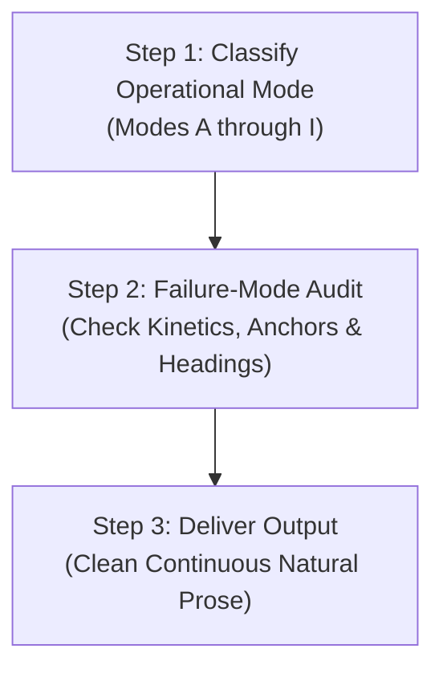

# Gemini Omni 1.1 Prompting Handbook (2026 Edition)

This handbook provides the authoritative prompt engineering standards for **Google DeepMind's Gemini Omni 1.1** (`gemini-omni-1.1-flash-preview`). It establishes deterministic prompt formulations for photorealistic video and synchronized diegetic audio generation, incorporating the **Seedance 2.5 Kinetic Physics Engine** to eliminate floatiness, object morphing, and visual drift.

*(Historical Context Note: Earlier 3.1 generation models provided foundational text-to-video baselines, but active production in 2026 mandates `gemini-omni-1.1-flash-preview` for video/audio synthesis, `gemini-4-argon` for creative direction, and `gemini-3.8-flash` for high-throughput prompt generation.)*

---

## 1. How Gemini Omni Thinks & The Prescription Spectrum

### 1.1 How Gemini Omni Thinks
Gemini Omni 1.1 is an autoregressive and diffusion-hybrid multimodal model trained on vast spatial-temporal video, audio, and physical datasets. Unlike decoupled text-to-video systems that generate silent frames and later synthesize audio through separate models, Gemini Omni models visual frames and synchronized 48kHz acoustic waveforms simultaneously within a shared latent manifold.

When interpreting a prompt, Gemini Omni balances three distinct internal priors:
1. **World-Knowledge Prior**: Broad cinematic and commonsense physical understanding (how sunlight bounces off wet asphalt, how heavy coats drape over shoulders).
2. **Kinetic Inertia Prior**: An innate tendency toward conservative, low-acceleration movement ("Physical Conservatism"). Unless explicitly directed with real-time speed locks and contact points, high-speed motions default to floaty or slow-motion dynamics.
3. **Multimodal Co-occurrence**: Diegetic acoustic events (foley clicks, engine revs, footsteps) are tied frame-by-frame to physical collision timestamps in the visual channel.

### 1.2 The Prescription Spectrum (Regime 1 vs. Regime 2)

Prompts fall into one of two operational regimes along the Prescription Spectrum:

```
                      THE PRESCRIPTION SPECTRUM
   Low Prescription                                      High Prescription
   (World-Knowledge)                                    (Kinetic & Physical)
  ◄────────────────────────────────────────────────────────────────────────►
   REGIME 1: Atmospheric & Narrative          REGIME 2: Kinetic Action & Precision
   • Landscapes, ambient lighting             • Fast martial arts, sports, acrobatics
   • Contemplative dialogue scenes            • Mechanical product assemblies (ASMR)
   • Organic fluid motion, weather            • High-speed vehicle pursuits, whip-pans
   • Trust model's cinematic priors           • Strict Seedance 5-part contact chains
```

- **Regime 1 (Atmospheric & Narrative)**:
  - *When to use*: Establishing landscape shots, slow emotional portraits, natural weather phenomena, architectural walkthroughs, and dialogue scenes with minimal physical interaction.
  - *Formulation Strategy*: Describe scene mood, sensory environment, lighting color temperature, and emotional tenor. Avoid micromanaging micro-movements so the model draws upon rich cinematic world knowledge.
- **Regime 2 (Kinetic Action & Precision Commercial)**:
  - *When to use*: Fast-paced commercial ads (e.g., IKEA self-assembly, SEPHORA runway struts), combat sequences, tactile product interactions, and rapid camera choreography.
  - *Formulation Strategy*: Apply exhaustive kinetic constraints: the 5-Part Contact Chain, 1.0x real-time speed locks, CRAFT camera routing, serialized 3-beat action lanes, and rigid positive physical invariants.

---

## 2. The 5 Official Core Elements of a Baseline Prompt

Every production prompt for Gemini Omni must define five core dimensions:

```
┌─────────────────────────────────────────────────────────────────────────┐
│                      THE 5 OFFICIAL CORE ELEMENTS                       │
├───────────────────┬─────────────────────────────────────────────────────┤
│ 1. Shot Framing   │ Shot size (Wide, MCU, ECU), camera movement (dolly, │
│    & Motion       │ pan, whip-pan, crane), and camera rig hardware.     │
├───────────────────┼─────────────────────────────────────────────────────┤
│ 2. Action         │ Explicit physical trajectories, real-time rates of  │
│                   │ motion, and verifiable cause-and-effect events.     │
├───────────────────┼─────────────────────────────────────────────────────┤
│ 3. Location       │ Spatial geometry, architecture, floor materials,    │
│                   │ surface friction, and background depth planes.      │
├───────────────────┼─────────────────────────────────────────────────────┤
│ 4. Lighting       │ Primary light sources, Kelvin temperature, shadow   │
│                   │ density, bounce fill, and atmospheric diffusion.    │
├───────────────────┼─────────────────────────────────────────────────────┤
│ 5. Style & Audio  │ Film stock/digital sensor profile, grain, aspect    │
│                   │ ratio, synchronized diegetic foley, and score.      │
└───────────────────┴─────────────────────────────────────────────────────┘
```

1. **Shot Framing & Motion**:
   - Explicit shot size: `Wide-angle establishing`, `Medium close-up (MCU)`, `Extreme close-up (ECU)`.
   - Camera movement: `Dolly-in 50cm`, `Horizontal 90-degree whip-pan`, `Arcing 45-degree Steadicam orbit`.
   - Rig type: `Film camera on locked-off tripod`, `Heavy studio dolly`, `Steadicam with natural human breathing`.
2. **Action**:
   - Sequential cause-and-effect beats.
   - Exact contact points between actors, props, and floors.
3. **Location**:
   - Physical room dimensions and architectural surfaces (`pale blonde ash floorboards`, `rain-slicked cobblestones`).
   - Ground friction and environmental stability.
4. **Lighting**:
   - Key light angle and color balance (`low-angled morning Scandinavian sunlight at 5200K`).
   - Fill and practical lights (`3200K tungsten streetlamps`, `soft 6500K ambient room bounce`).
   - Atmospheric scattering (`fine dust motes in sunbeam`, `subtle neon rain mist`).
5. **Style & Audio**:
   - Optical profile: `Shot on Arri Alexa 65 with 50mm Prime lens at f/2.8`.
   - Native synchronized audio: Specific foley triggers, room acoustics, and musical cues.

### Official DeepMind Baseline Example
The following is an exemplary DeepMind baseline prompt illustrating all 5 core elements functioning in unity:

```text
A cinematic, wide shot capturing a woman standing on the edge of a dramatic coastal cliff at sunset. Warm golden light bathes the rugged landscape and casts long shadows across the rocky ground. The woman, wearing a flowing crimson dress, gazes thoughtfully toward the crashing waves far below. The camera slowly dollies forward toward the woman at 1.0x real-time speed, maintaining deep focus on both her silhouette and the ocean horizon. Shot on 35mm film stock with rich, natural grain and warm color balance. Synchronized diegetic audio features the rhythmic crashing of ocean breakers against sea cliffs, a soft coastal breeze blowing through tall sea grass, and distant gulls calling overhead.
```

*Element Breakdown*:
- **Framing & Motion**: Cinematic wide shot; camera slowly dollies forward toward the woman; deep focus maintained.
- **Action**: Woman gazes thoughtfully toward crashing waves far below; dress flutters in the wind at 1.0x real-time speed.
- **Location**: Edge of a dramatic coastal cliff overlooking the ocean with rugged rocky terrain.
- **Lighting**: Sunset, warm golden light casting long shadows across the ground.
- **Style & Audio**: 35mm film stock, rich natural grain, warm color balance; synchronized crashing breakers, breeze through grass, distant gulls.

---

## 3. ALL 11 Official DeepMind Capabilities & Prompt Patterns

Gemini Omni 1.1 natively supports 11 core creative capabilities through Google GenAI's Interactions API:

### 3.1 Iterative Conversational Editing (In-Place Modification)
Gemini Omni retains state across multi-turn sessions using `previous_interaction_id`. You can modify specific visual elements while preserving camera positioning, timing, and unmentioned subjects:
- **Prompt Pattern**: `"In the previous clip, keep the woman's exact walking trajectory, camera tracking speed, and the cobblestone street identical, but change her wool peacoat from charcoal gray to vivid crimson red."`
- **Rule**: Explicitly state what remains locked (`"keep camera, background, and timing identical"`) before stating the single isolated modification.

### 3.2 Directing & Editing Camera Work
Gemini Omni can execute complex camera choreographies without visual glitching when instructed using standard cinematography terminology:
- **Prompt Pattern**: `"The camera begins locked off at eye level in an extreme close-up of the actor's eyes. On the dialogue cue 'Now', the camera executes a rapid 90-degree whip pan to the right, landing in a stabilized medium-wide two-shot of the entrance door."`
- **Supported Rigs**: Tripod lock-off, Steadicam tracking, Technocrane vertical jib, Dutch tilt (roll axis), whip-pan, and drone flyover.

### 3.3 Audio-Visual Synchronization
Unlike older silent video engines, Gemini Omni generates 48kHz stereo audio aligned frame-for-frame with visual collisions:
- **Prompt Pattern**: `"At second 04, as the porcelain teacup strikes the marble tabletop, produce a crisp, high-frequency ceramic 'clink' accompanied by a short 0.2-second acoustic room reverb tail."`
- **Coupling Dimensions**:
  * *Diegetic Foley*: Footsteps on specific floor textures, mechanical snaps, fabric friction.
  * *Room Tone*: Reverberation time, acoustic damping (carpeted studio vs. cavernous stone hall).
  * *Dialogue*: Spoken words locked to lip movement.

### 3.4 World Understanding & Conceptual Visualization
Gemini Omni leverages Gemini's reasoning architecture to visualize abstract, scientific, historical, or metaphorical concepts:
- **Prompt Pattern**: `"A cross-sectional cinematic 3D visualization showing the interior of a human arterial capillary at 1.0x real-time speed. Red blood cells deform smoothly as they squeeze single-file through the endothelial lumen under soft bioluminescent lighting, accompanied by a rhythmic, muffled hydrodynamic pulse."`

### 3.5 Synchronized Kinetic Text Rendering (The 4 Levers: Type, Placement, Animation, Exposure)
Gemini Omni can render sharp, legible graphic text integrated into the scene when controlled via the 4 Levers:
1. **Type**: Exact font styling, weight, casing, and color (e.g., `"Bold sans-serif typography in matte golden yellow"`).
2. **Placement**: Spatial positioning (e.g., `"Centered in the lower-third with 10% bottom margin"` or `"Integrated onto the brick wall surface in perspective"`).
3. **Animation**: Entry and exit dynamics (e.g., `"Letters wipe on from left to right over 0.8 seconds"`).
4. **Exposure**: On-screen duration (e.g., `"Appears at second 02 and remains completely static until second 08"`).
- **Prompt Pattern**: `"Bold white sans-serif text reading 'SEPHORA' cleanly tracks across the lower-third from left to right between seconds 02 and 06, remaining perfectly sharp with zero glyph warping."`

### 3.6 Combining Multimodal Ingredients (<video>, <image>, <audio>)
Gemini Omni accepts up to 3 reference images (`<image_1>`, `<image_2>`, `<image_3>`), 1 reference video (`<video>`), and 1 reference audio track (`<audio>`):
- **Prompt Pattern**: `"Using the character face and hair from <image_1>, place her inside the architectural loft shown in <image_2>. Animate her walking forward matching the camera motion and pace of <video>, synchronized to the driving drum rhythm of <audio>."`

### 3.7 Applying New Styles & Multi-Part Stylistic Progressions
Transform existing video footage into new artistic aesthetics or direct progressive in-scene style transitions:
- **Prompt Pattern**: `"Transform the incoming video reference into hand-drawn 1980s anime cel animation. Preserve the actor's facial expression and timing, but render line work in crisp black ink with flat gouache color fills and subtle film grain."`
- **Multi-Part Progression**: `"The video begins in black-and-white 16mm film noir. At second 05, vibrant saturated Technicolor blossoms outward from the protagonist's fingertip touch, washing over the entire frame."`

### 3.8 Storyboard-to-Video Generation
Condition generation on a multi-panel storyboard grid (such as a 2x2 pre-vis sheet):
- **Prompt Pattern**: `"Animate the 4 panels of the storyboard grid in <image_1> sequentially from top-left, to top-right, to bottom-left, to bottom-right, smoothly transitioning between each keyframe at 1.0x real-time speed."`

### 3.9 Extending Scenes for Longer Storytelling (Up to 40 Seconds)
Extend an established clip in +10 second increments through iterative chaining:
- **Turn 1 (0-10s)**: Base establishing shot.
- **Turn 2 (10-20s)**: Camera continues forward through the doorway into the next room (`previous_interaction_id=interaction_1`).
- **Turn 3 (20-30s)**: Subject turns toward the window as rain begins to fall (`previous_interaction_id=interaction_2`).
- **Turn 4 (30-40s)**: Subject steps outside into the garden terrace (`previous_interaction_id=interaction_3`).

### 3.10 Specifying First and Last Frames (Transitions & Seamless Loops)
Lock boundary conditions for seamless video interpolation or infinite social loops:
- **Seamless Loop Pattern**: `"The shot begins and ends with the exact camera framing, subject pose, and lighting depicted in <image_1>. The camera executes a complete 360-degree circular orbit around the motionless ballerina, returning perfectly to the starting frame at second 10 for a seamless infinite loop."`
- **A-to-B Interpolation Pattern**: `"The scene begins at frame 0 matching <image_1> and continuously evolves into the final frame composition of <image_2> over 10 seconds without cut or splice."`

### 3.11 Ecosystem Integration: Gemini App (gemini.google.com) vs. Google Flow (flow.google)
Gemini Omni operates across two primary Google environments:
- **Gemini App (`gemini.google.com`)**: Conversational consumer interface ideal for rapid single-prompt generation, iterative in-place chat modifications, and quick video concept previews.
- **Google Flow (`flow.google`) / GenAI API**: Node-based enterprise and production workflow platform supporting multi-asset conditioning, timeline chaining, batch production runs, and ADK multi-agent orchestrations.

---

## 4. Where Gemini Omni Falls Short vs. Seedance & How to Fix It

While Gemini Omni excels at photorealism, multimodal audio, and semantic reasoning, its raw out-of-the-box text-to-video pipeline exhibits notable failure modes compared to the **Seedance 2.5 Kinetic Physics Engine**. The following matrix summarizes these gaps and their deterministic fixes:

```
┌────────────────────────────────┬────────────────────────────────┬────────────────────────────────┐
│ Gemini Omni Default Tendency   │ Seedance 2.5 Kinetic Upgrade   │ Deterministic Prompt Fix       │
├────────────────────────────────┼────────────────────────────────┼────────────────────────────────┤
│ 1. Physical Conservatism       │ Kinetic Contact Chain (4.1)    │ Mandate 5 sequential phases:   │
│    (Collisions lack punch;     │                                │ Initiation -> Contact -> Force │
│    strikes decelerate early)   │                                │ Transfer -> Evidence -> Stance │
├────────────────────────────────┼────────────────────────────────┼────────────────────────────────┤
│ 2. Unmotivated Slow-Motion     │ Real-Time Speed Lock (4.2)     │ Universal lock sentence: "All  │
│    (Actions drift into floaty  │                                │ action occurs at natural 1.0x  │
│    dreamlike pacing)           │                                │ real-time speed, no slow-mo"   │
├────────────────────────────────┼────────────────────────────────┼────────────────────────────────┤
│ 3. Camera Wandering & Drift    │ CRAFT Camera Telemetry (4.3)   │ Single dominant vector tied to │
│    (Unmotivated wobble and     │                                │ physical on-screen anchor beat;│
│    accidental axis crossing)   │                                │ specify rig & focal length     │
├────────────────────────────────┼────────────────────────────────┼────────────────────────────────┤
│ 4. Concurrent Action Jamming   │ Serialized Action Lanes (4.4)  │ Max 3 serialized beats per     │
│    (Actors morph when doing    │                                │ 8-10s window (Beats 1, 2, 3 in │
│    simultaneous actions)       │                                │ non-overlapping seconds)       │
├────────────────────────────────┼────────────────────────────────┼────────────────────────────────┤
│ 5. Multi-Subject Limb Bleed    │ High Wardrobe Polarity (4.4)   │ Extreme visual contrast (e.g.  │
│    (Identities blend when      │                                │ scarlet gloss coat vs. matte   │
│    characters cross paths)     │                                │ charcoal blazer with cuffs)    │
├────────────────────────────────┼────────────────────────────────┼────────────────────────────────┤
│ 6. Rubber/Elastic Rigidity     │ Positive Physical Invariants   │ Explicit mechanical rigidity:  │
│    (Boxes and tools bend       │ (4.5)                          │ "Rigid 90-deg edges, solid ash │
│    or distort during impacts)  │                                │ floor, no object morphing"     │
├────────────────────────────────┼────────────────────────────────┼────────────────────────────────┤
│ 7. Multi-Reference Clutter     │ "One Job Per Reference" (4.6)  │ Explicit inclusion + exclusion │
│    (Model borrows unintended   │                                │ boundaries per <image_N> tag   │
│    details from attached refs) │                                │ (e.g., inherit face only)      │
├────────────────────────────────┼────────────────────────────────┼────────────────────────────────┤
│ 8. Markdown Text Hallucination │ Clean Natural Prose Rule (4.6) │ Zero internal markdown headers │
│    (Model paints '### Camera:' │                                │ inside prompt string; single   │
│    on screen as text graphic)  │                                │ continuous paragraph of prose  │
└────────────────────────────────┴────────────────────────────────┴────────────────────────────────┘
```

### 4.1 The 5-Part Kinetic Contact Chain
Every physical collision, strike, or tactile interaction must be structured across five sequential phases:

$$\text{1. Initiation} \longrightarrow \text{2. Contact Point} \longrightarrow \text{3. Force Transfer} \longrightarrow \text{4. Environmental Evidence} \longrightarrow \text{5. Recovery Stance}$$

*Example*:
> "Fighter A steps forward 1.2m (Initiation), palm strikes Fighter B's sternum (Contact Point). The impact halts Fighter A's forward momentum while driving Fighter B backward (Force Transfer). Fighter B's rubber boot slides 25cm across the concrete, leaving visible scuff marks and dust (Environmental Evidence). Both fighters re-center their balance into ready stances with 2m of clear space between them (Recovery Stance)."

### 4.2 Velocity, Gravity & Quantitative Anchors
To prevent unwanted slow-motion, floating, or dreamlike physics, mandate the universal speed lock sentence in all Regime 2 prompts:
> **"All action occurs at natural, real-time 1.0x playback speed with no slow motion, no time-ramping, and no floating. Heavy physical gravity and unyielding ground friction govern the scene."**

### 4.3 CRAFT Camera Routing Framework
Prevent camera wandering and unmotivated drift with the CRAFT framework:
- **C (Composition)**: Initial framing, aspect ratio, and subject coordinates.
- **R (Route)**: Exactly one dominant trajectory per shot (`first push-in, then hold static`).
- **A (Action Anchor)**: Camera moves must be triggered by an on-screen physical action (e.g., *"triggered by the eyelid wink, camera whip-pans 90 degrees right"*).
- **F (Focus & Axis Invariant)**: Explicit preservation of the 180-degree line and focal plane.
- **T (Tone / Rig)**: Tangible physical hardware emulation (e.g., `Technocrane on 35mm lens at f/4`).

### 4.4 Serialized Action Lanes & Visual Polarity
- **Serialized Lanes**: In an 8-10 second clip, command at most **3 serialized cause-and-effect beats** (Beat 1: Seconds 0-3, Beat 2: Seconds 3-6, Beat 3: Seconds 6-10). Never command overlapping complex actions simultaneously.
- **Wardrobe Polarity**: When multiple characters share a frame, assign extreme visual contrast (e.g., *"Character A in high-gloss scarlet trench coat; Character B in matte charcoal blazer with white cuffs"*) to prevent limb blending or identity entanglement.

### 4.5 Positive Physical Invariants
State what remains mechanically rigid and immutable:
> *"The flat-pack cardboard box remains mechanically rigid with sharp 90-degree edges throughout, and the hardwood floor maintains unyielding solid ash geometry. One continuous shot, no jump cuts, no slow motion, no duplicated limbs, and no object morphing."*

### 4.6 "One Job Per Reference" Asset Binding
Give each attached reference image a singular, strictly defined role:
- `<image_1>`: Inherit facial features and wardrobe silhouettes ONLY. Exclude background.
- `<image_2>`: Inherit room architecture, flooring, and lighting ONLY. Exclude characters.
- `<image_3>`: Inherit opening camera composition at $t=0.0s$ ONLY. Exclude subsequent action.

---

## 5. LLM Workflow: How to Build Any Gemini Omni Prompt

When generating Gemini Omni prompts programmatically, execute this three-step workflow:



### Step 1: Classify the Operational Mode (Modes A through I)
Identify the primary operational mode of the requested sequence:
- **Mode A: Atmospheric & World Exploration (Regime 1)**: Wide vistas, landscapes, contemplative character portraits, natural lighting.
- **Mode B: High-Kinetic Action & Physical Collision (Regime 2)**: Martial arts, vehicle chases, sports stunts with 5-part contact chain.
- **Mode C: Tactile Commercial & Product Macro (Regime 2)**: ASMR, food prep, luxury packaging, mechanical unpackaging.
- **Mode D: Conversational In-Place Edit (Iterative Multi-Turn)**: Multi-turn modification using `previous_interaction_id`.
- **Mode E: Multi-Ingredient Reference Synthesis**: Combining up to 3 images, 1 video, and 1 audio track.
- **Mode F: First-to-Last Frame Interpolation or Loop**: Transitions between start/end frames or seamless looping.
- **Mode G: Multi-Panel Storyboard-to-Video**: Sequencing a 2x2 storyboard keyframe grid into unbroken video.
- **Mode H: Kinetic Text & Motion Graphics**: Legible typography animated via the 4 Levers (Type, Placement, Animation, Exposure).
- **Mode I: Continuous Scene Extension (+10s Intervals up to 40s)**: Unbroken oners chained across multiple turns.

### Step 2: Failure-Mode Audit
Run the proposed prompt through the pre-output audit:
1. Is it Regime 2? If yes, verify the 1.0x real-time speed lock sentence is present.
2. Are physical contacts broken down into Initiation $\to$ Contact $\to$ Force $\to$ Evidence $\to$ Recovery?
3. Are action beats limited to $\le 3$ serialized steps?
4. Are reference images limited to $\le 3$ tags?
5. Does the camera follow CRAFT guidelines?
6. Is synchronized diegetic audio explicitly scripted?
7. Are there any internal markdown headers? (Must be stripped!).

### Step 3: Deliver Output
Emit the final prompt as a **single, continuous paragraph of natural prose** without markdown headers or bullet points.

---

## 6. 10 Copy-Paste Master Prompt Templates

### Template 1: Commercial Kinetic Product Assembly (Regime 2 — IKEA Style)
```text
A locked-off wide-angle architectural shot captures an empty, pristine Scandinavian room with pale blonde ash wood floors and sunlit white walls, based on the spatial layout of <image_2>. In the exact dead-center of the floor rests a sealed kraft cardboard flat-pack furniture box matching the design in <image_1>. All action occurs at natural, real-time 1.0x playback speed with unyielding physical gravity and zero slow motion. For the first three seconds, the box sits in dead stillness under warm morning sunlight streaming through tall left windows. At second 03, the box begins to tremble and vibrate with intense, tactile micro-tremors, rattling crisply against the rigid hardwood floor without shifting location. At second 07, the center packing tape violently splits open, releasing a small puff of kraft dust as the top cardboard flaps spring slightly upward. The camera remains completely fixed on its tripod with zero movement, zero drift, and tack-sharp deep focus. One continuous shot, no jump cuts, no duplicated parts, and no object morphing. Synchronized diegetic audio begins with dead-silent empty room tone, followed by the dry resonant woody rattling of cardboard against ash flooring, culminating in a sharp, hyper-tactile cardboard pop and tearing tape sound.
```

### Template 2: High-Fashion Vertical Runway Whip-Pan (Regime 2 — SEPHORA Style)
```text
A 9:16 vertical high-fashion cinematic sequence begins in an extreme macro close-up on Model Maya's face matching <image_1>, focusing on her left eye adorned with shimmering emerald and gold holographic eyeshadow and immaculate winged eyeliner. Raindrops glisten on her cheek under wet Soho neon lighting at real-time 1.0x playback speed with zero slow motion. At second 02, Maya delivers a sharp, confident wink directly into the lens and whispers: "London, wake up." Triggered precisely by the eyelid closing, the vertical 50mm camera executes a high-speed horizontal whip-pan to the right, blurring neon lights into electric streaks before snapping to a halt in a medium-wide shot of a rain-slicked Soho cobblestone avenue, where an iconic red London double-decker bus streaks past in the background with wet asphalt tire hiss. Maintain crisp focal planes, rich saturated magenta and cyan reflections, and zero digital artifacting. Synchronized diegetic audio starts with the intimate, dry sound of an eyelid blink and whispered vocal close to mic, slamming instantly into a punching 138 BPM UK Garage drum hit, a whooshing whip-pan sound effect, and the wet tire spray of the passing bus.
```

### Template 3: Atmospheric Contemplative Dialogue (Regime 1 — A24 Narrative)
```text
A 10-second continuous cinematic shot filmed at natural, real-time 1.0x playback speed in an overcast coastal greenhouse. Using the provided references: inherit the protagonist's facial features and weathered navy wool peacoat from <image_1>, and the foggy coastal glasshouse architecture and soft 5600K diffused daylight from <image_2>. The camera begins locked off in an eye-level medium profile framing the character leaning against a weathered cedar workbench, gazing through condensation-streaked glass at distant crashing waves. Over seconds 3 to 7, the camera initiates a slow, imperceptible 30cm dolly push-in toward the character's profile as they exhale a soft plume of warm breath against the cool air and murmur: "The tide is coming early." Maintain natural skin pores, realistic wool fabric weave, and quiet atmospheric depth with no jump cuts and no morphing. Synchronized diegetic audio features the steady, muffled rhythmic boom of distant ocean surf, the delicate patter of rain mist hitting glass panes, quiet wooden room creaks, and clear, close-mic spoken dialogue.
```

### Template 4: Tactile ASMR Food Preparation (Regime 2 — Macro Precision)
```text
An extreme close-up macro commercial shot at real-time 1.0x playback speed on a locked-off 100mm macro lens at f/4.0. Resting on a dark honed slate culinary surface, a chilled block of salted cultured butter sits under soft 4500K studio softbox illumination. At second 02, a heavy Damascus steel chef's knife enters frame from the top right, held by a steady hand. At second 04, the razor edge makes contact with the butter surface, slicing downward with unyielding mechanical resistance. As the blade reaches the bottom slate surface at second 07, a translucent curl of butter peels upward with micro-wrinkles along its crest, and the knife strikes the slate with a solid acoustic tap. All movement obeys natural gravity with zero floating and zero rubbery flexing. Synchronized diegetic ASMR audio captures the dry metallic slide of the blade entering the butter, the soft fibrous shearing sound of dense dairy, and the crisp, resonant clink of steel meeting stone, supported by dead-silent culinary studio room tone.
```

### Template 5: High-Kinetic Combat Exchange (Regime 2 — Seedance Contact Chain)
```text
A 10-second continuous single-take action sequence filmed at natural, real-time 1.0x playback speed with heavy physical gravity, unyielding floor friction, and sharp momentum deceleration. Using the provided references: inherit Fighter A's facial features and cobalt-blue denim jacket from <image_1>, the warehouse concrete architecture and overhead sodium-vapor lighting from <image_2>, and the opening 2.5-meter combat spacing from <image_3>. Fighter B wears contrasting matte-charcoal combat trousers and a crisp white compression shirt. An eye-level medium-wide camera holds static on a stabilized dolly track, keeping both fighters in profile focus without crossing the 180-degree axis. Over seconds 0 to 3, Fighter A steps forward 1.2 meters and launches a right palm strike toward Fighter B's chest. Over seconds 3 to 6, Fighter B pivots 45 degrees to deflect the strike with a rigid two-handed forearm block; on impact, Fighter A's forward momentum halts abruptly while Fighter B's right boot slides 25 centimeters backward across the concrete floor, kicking up visible chalk dust. Over seconds 6 to 10, Fighter B pushes back, and both fighters step apart to re-establish balanced defensive stances with 2 meters of clear floor visible between them. Maintain complete prop rigidity, zero limb duplication, zero motion blur aberration, and zero floaty slow-motion. Synchronized diegetic audio captures rubber boot squeals on concrete, sharp denim fabric snaps, a heavy dull forearm impact thud, and controlled breathing with natural warehouse acoustic reverb.
```

### Template 6: Continuous Tracking Oner (+10s Extension Base Clip — Mode B / Mode I)
```text
A 10-second continuous 9:16 vertical tracking shot glides backward at natural 1.0x real-time speed ahead of Model Maya, who struts down a rain-slicked Soho cobblestone avenue at midnight. Maya wears a high-gloss scarlet-red patent trench coat with metallic stiletto boots, her eyes adorned with vivid holographic emerald eyeshadow matching <image_1>. Neon signage from vintage clubs reflects across the wet asphalt as an iconic red London bus streaks past in the background. Maya approaches the glowing glass facade of a SEPHORA flagship, her heels clicking crisply against the stones. The camera holds a steady 2-meter distance at chest height with subtle Steadicam breathing. One continuous unbroken shot, no jump cuts, no time-ramping. Synchronized diegetic audio features rhythmic stiletto clicks, wet tire hisses, city rain mist, and a skipping 138 BPM UK Garage drum rhythm, ending as Maya extends her hand to push open the store entrance.
```

### Template 7: Continuous Tracking Oner (+10s Extension Turn 1 — Mode B / Mode I)
```text
The camera continues backward in one unbroken continuous shot through the opening glass doors as Maya struts inside without missing a beat, maintaining identical scarlet patent trench styling and physical pacing from the preceding interaction. The lighting shifts dynamically from wet moody London night into brilliant 5600K diffused beauty lighting bouncing off black-lacquered mirrored aisles. Model Kaelen, wearing a tailored charcoal blazer with chalk-white striped cuffs matching <image_2>, steps smoothly into frame alongside her. Kaelen flicks open a gold lipstick case with a crisp mechanical snap, smiling as Maya whispers: "London, wake up." The 138 BPM music drops into a heavy Moog bassline as both models strut in side-by-side synchronization down the central cosmetics corridor. One continuous shot, no jump cuts, no morphing. Synchronized audio seamlessly blends the pneumatic door whoosh, magnetic lipstick snap, and driving bassline.
```

### Template 8: Commercial Industrial Product Macro Showcase (Regime 2 / Mode C)
```text
A commercial macro product sequence filmed at 1.0x real-time speed on a 120mm macro cinema lens at f/5.6. A luxury matte-black ceramic wristwatch matching <image_1> rests horizontally on an elevated obsidian pedestal under a clean commercial strip softbox. Over seconds 0 to 4, the camera executes a micro-dolly track across the bezel from left to right, capturing the razor-sharp reflection of the strip light gliding over the bead-blasted zirconia surface. At second 04, a gloved watchmaker's thumb enters frame and rotates the knurled winding crown clockwise: the crown turns with visible micro-ratchet resistance, producing four sharp mechanical clicks. At second 08, the sweeping red second hand begins fluid, continuous motion around the dial with zero stutter. The pedestal and watch retain absolute geometric rigidity throughout. Synchronized diegetic audio captures the hyper-intimate tactile clicks of the watch crown mechanism, the soft whisper of cotton glove friction, and pristine studio silence.
```

### Template 9: Automotive Dynamic Tracking Shot (Regime 2 / Mode B)
```text
A low-angle dynamic tracking shot mounted on an unyielding chase crane 80cm above the asphalt, tracking a matte-gunmetal sports sedan matching <image_1> at 1.0x real-time playback speed. The vehicle carves smoothly through a mountain hairpin turn at 60 km/h in late afternoon 4800K sunlight. Over seconds 0 to 4, the camera tracks in front of the front-left wheel, showing the high-performance tire gripping the asphalt with heavy lateral friction as the suspension compresses 5cm under G-forces. Over seconds 4 to 8, the camera cranes upward and arcs around the driver's side to reveal the sweeping valley vista behind. The vehicle body panels remain solid and distortion-free with accurate specular highlights gliding across the metallic paint. Synchronized audio features the throaty roar of a twin-turbo V6 engine accelerating out of the apex, heavy tire scrub friction against textured asphalt, and rushing wind noise across the microphone.
```

### Template 10: Sci-Fi Architectural World-Building (Regime 1 / Mode A)
```text
An ultra-wide establishing panoramic shot filmed on a 24mm cinema prime lens at f/4.0, slowly tracking forward at 1.0x real-time speed across the upper terrace of a brutalist planetary research station at twilight. Massive monolithic concrete pylons rise into an atmospheric amber sky illuminated by a twin moon transit. Delicate glowing cyan holographic telemetry displays hover statically along the terrace railing without flickering or jittering. In the midground, research technicians in minimalist white thermal suits walk with natural physical gait along the transit walkway. The camera glides on a straight 2-meter track with majestic cinematic weight and deep architectural depth of field. Maintain stable geometric verticals and atmospheric volumetric dust particles catching twilight bounce. Synchronized audio layers the deep, low-frequency atmospheric hum of the station's geothermal generators, distant thermal wind gusts, and quiet spatial electronic chirps.
```

---

## 7. 7-Item Pre-Output Verification Checklist

Before emitting any prompt to Gemini Omni 1.1, audit against this checklist:

- [ ] **1. Clean Natural Prose**: Is the prompt a single flowing paragraph completely free of raw markdown headers (`### Camera:`, `### Lighting:`)?
- [ ] **2. 1.0x Real-Time Speed Lock**: Does the prompt include the explicit 1.0x speed lock sentence and gravity anchor for Regime 2 scenes?
- [ ] **3. Reference Tag Ceiling ($\le 3$)**: Are there at most 3 image references (`<image_1>`, `<image_2>`, `<image_3>`), each with an explicit inclusion/exclusion clause?
- [ ] **4. Seedance Contact Chain**: Are tactile impacts and interactions structured with Initiation $\to$ Contact $\to$ Force Transfer $\to$ Evidence $\to$ Recovery?
- [ ] **5. Serialized 3-Beat Pacing**: Are action beats serialized into at most 3 sequential cause-and-effect steps across the 8-10s window?
- [ ] **6. CRAFT Camera Specification**: Are Composition, Route, Action Anchor, Focus, and Tone/Rig clearly defined without unmotivated wandering?
- [ ] **7. Multimodal Audio Coupling**: Does the prompt specify native synchronized foley, room acoustics, dialogue, and score progression?
